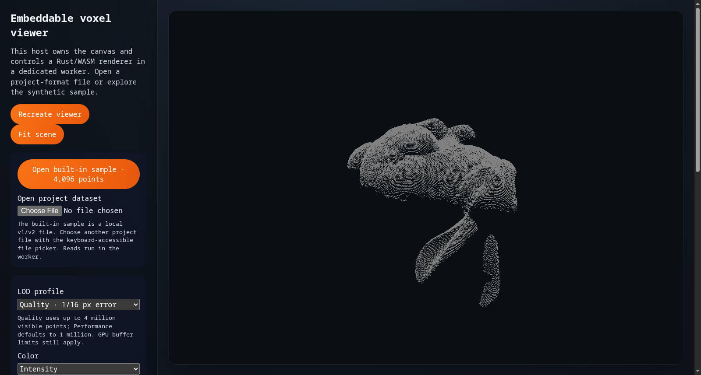
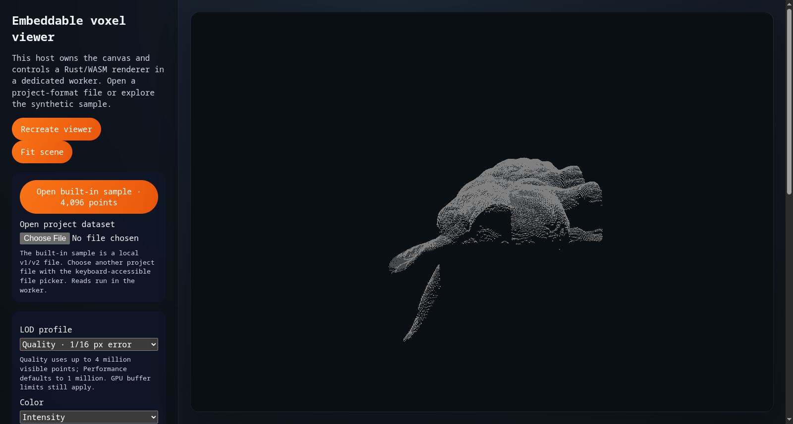
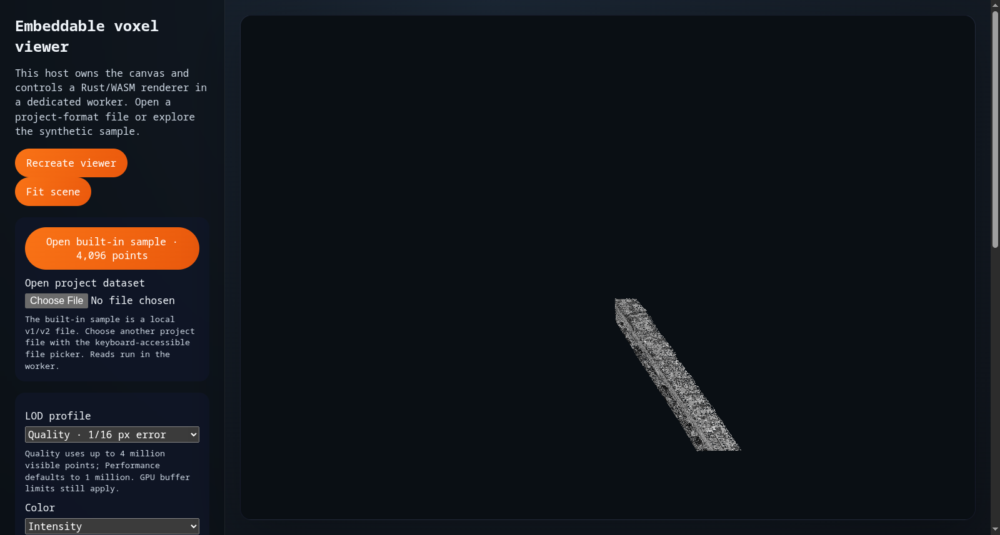
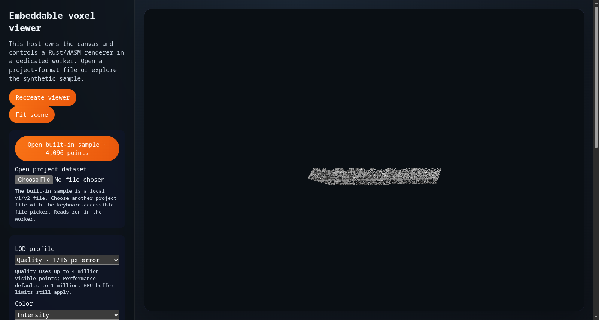

# Octree Viewer

Visor extensible de nubes LiDAR y nubes de puntos 3D, construido en Rust y ejecutable en el
navegador mediante WebAssembly. El proyecto está en una fase temprana: hoy contiene un núcleo de
voxelización en memoria, una importación LAS/LAZ incremental, un lector espacial por bloques y una
demo WebGPU 3D con worker, navegación y perfiles LOD. Aún no puede explorar datasets de cientos de GB
de extremo a extremo; la demo informa bytes únicos leídos y permite cancelar reiniciando el worker.

## Intención del proyecto

La meta es ofrecer una base de visualización que pueda explorar datasets LiDAR mayores que la
memoria disponible sin cargarlos completos. El visor debe leer progresivamente una estructura
espacial persistente, elegir solo los bloques que necesita la vista y mantener un presupuesto
acotado de memoria, transferencia y renderizado.

La ambición es superar a Potree en dimensiones concretas que podamos medir —por ejemplo tiempo hasta
la primera vista, latencia al navegar, memoria máxima, coste de conversión y facilidad para añadir
nuevos atributos, fuentes o renderizadores— conservando visualización web y una ruta WASM en Rust.
“Más potente y eficiente” es una dirección, no una afirmación demostrada: se tendrá que comparar
contra Potree con los mismos datasets, equipo, configuración y criterios de calidad visual.

Una capacidad requerida es **un formato de almacenamiento propio, versionado y optimizado para el
visor**, pensado para conversión, acceso espacial aleatorio y lectura progresiva de datasets LiDAR
de más de 500 GB. LAS/LAZ seguirán siendo formatos de entrada; el formato del proyecto será una
representación de trabajo optimizada para visualizar. La compatibilidad con COPC/EPT se evaluará
como interoperabilidad, sin sustituir el requisito del formato propio.

El objetivo de escala se refiere a explorar progresivamente una nube cuyo dataset fuente supere los
500 GB. No significa mantener todos sus puntos en RAM o dibujarlos simultáneamente. Antes de declarar
el soporte completo se deben fijar los atributos incluidos y el hardware y navegador que forman parte
del objetivo.

Para las mediciones del proyecto, **500 GB significa el tamaño del archivo fuente LAS/LAZ antes de
convertir, en bytes decimales (`500.000.000.000 B`)**. El tamaño del `.oct` convertido se registra por
separado y no cuenta para alcanzar ese umbral. Cada dataset de benchmark debe documentar ambos tamaños,
conteo de puntos, atributos, CRS y distribución espacial.

## Principios de arquitectura

- **Lectura fuera de memoria:** no retener el dataset completo en RAM ni copiar la escena completa a
  JavaScript.
- **Memoria y representación compactas:** optimizar el uso de memoria en todas las etapas, usando
  los tipos más pequeños que permitan los rangos y la precisión requeridos. Para almacenamiento y
  transferencia, cuantizar coordenadas a enteros cuando sea viable —con `u32` como punto de partida—
  y reconstruirlas a coordenadas locales `f32` solo para los bloques que se van a visualizar. La
  cuantización debe declarar y respetar un error máximo; no debe perderse precisión de forma
  silenciosa.
- **Acceso espacial:** indexar datos en bloques jerárquicos independientes que puedan leerse,
  descomprimirse y descartarse por separado.
- **Nivel de detalle:** seleccionar detalle según cámara, tamaño proyectado y presupuesto, no solo
  cantidad total de puntos.
- **Granularidad visual objetivo:** tratar como extremos orientativos dos vóxeles por píxel en el
  extremo fino y 16 × 16 px por vóxel en el grueso. Para convertir el primer extremo a una medida
  lineal de celda, usar provisionalmente ≈0,5 px por arista y validar que esa interpretación refleja
  la densidad visual buscada. El LOD debe poder cargar niveles suficientemente pequeños para alcanzar
  el extremo fino cuando lo permitan la fuente y el presupuesto; los huecos por celdas sin puntos son
  aceptables y no se deben rellenar inventando geometría. El tamaño proyectado es una referencia de
  resolución, no una promesa de densidad de muestras. La ruta LOD voxelizada mide las doce aristas
  proyectadas de las celdas; la carga de muestras y la resolución de dibujo tienen contratos separados.
- **Vóxeles sin solapamiento:** en el modo voxelizado, cada punto representado pertenece a una celda
  ocupada de una retícula espacial alineada entre bloques y niveles. El corte visible no debe dibujar
  a la vez representantes de ancestros e hijos para la misma región; el tamaño de las caras tampoco
  debe exceder la celda. Se permiten caras contiguas y huecos donde no haya datos. Mantener todos los
  puntos fuente sin pérdida es una necesidad distinta del modo voxelizado y no basta para demostrar
  este invariante visual.
- **Contratos pequeños:** separar geometría, almacenamiento, lectura, consulta espacial y
  presentación para poder extenderlos sin acoplar el núcleo a WASM o `wgpu`.
- **Métricas antes de promesas:** toda afirmación de escala o rendimiento debe venir acompañada de
  dataset, hardware, configuración, límites y mediciones reproducibles.
- **Conversión recuperable:** preparar el dataset puede tardar; la conversión debe informar progreso,
  permitir cancelación y evitar perder el trabajo ya completado tras un fallo.

### Flujo objetivo de datos

La preparación de un dataset de cientos de GB y su exploración son trabajos distintos. La conversión
se plantea inicialmente como herramienta Rust nativa con uso de memoria acotado; el navegador abre
el resultado propio y lee solo metadatos y bloques requeridos por la vista. No se considera requisito
convertir 500 GB dentro de WASM.

```text
LAS/LAZ ──► conversor Rust nativo ──► formato propio versionado
                                         │
                               Blob local o lectura remota
                                         │
                 viewer_wasm ──► viewer_core: selección/LOD
                                         │
                               viewer_render_wgpu
                                         │
                                  host web 3D
```

## Estado actual del repositorio

Este inventario describe el árbol de trabajo actual; comprobar el estado de Git antes de asociarlo a
una versión publicada.

| Área | Estado observado | Límite actual |
| --- | --- | --- |
| `viewer_core` | Tipos de puntos, jerarquía AABB/frustum, selección LOD de reemplazo/aditiva, scheduler de bloques, caché LRU acotada y transiciones de cortes disponibles. | Jerarquía, scheduler y caché residen en memoria; el scheduler no ejecuta I/O. El presupuesto contabiliza el payload estimado, no el RSS ni la sobrecarga del allocator/índice. `SparseVoxelStore` mantiene voxeles en un `HashMap` y su filtro incluye por centro. |
| `viewer_render_wgpu` | Conversión a instancias, cámara orbital, modos de color, buffers GPU por bloque, escala visual uniforme y presupuesto configurable. | El límite GPU contabiliza buffers de instancias, no VRAM total. |
| `viewer_wasm` | Bindings para el visor, sesiones LAS/LAZ, presentación WebGPU y carga bajo demanda de bloques v1/v2/v3 al corte LOD. | El host aún debe crear el worker y gestionar sus mensajes/estados. |
| `examples/web-host` | Demo WebGPU en worker, muestra sintética, apertura de formato local, progreso por rangos, cancelación y perfiles LOD; se comprobó visualmente con Chrome en Bunny y Outer Banks. | No hay un escáner urbano de ejemplo en los archivos del repositorio; Firefox y la cancelación de una lectura local siguen pendientes. |
| Formato propio | Especificaciones v1/v2/v3, cuantizador `u32`, codec LZ4 por bloque, CRC32, escritor incremental y lector aleatorio con límites configurables ([`docs/FORMAT_V1.md`](docs/FORMAT_V1.md), [`docs/FORMAT_V2.md`](docs/FORMAT_V2.md), [`docs/FORMAT_V3.md`](docs/FORMAT_V3.md)). v1/v2 conservan su layout; v3 añade escala solo visual y conserva las semánticas existentes. | Fixtures prueban round-trip, bloques selectivos y lectura desde tickets del scheduler, corrupción, límites, semánticas, escala y compatibilidad. XYZ `u32` conserva 12 bytes por punto, igual que `f32`; el ahorro aplica frente a `f64`. |
| Pruebas y rendimiento | Hay tests pequeños de núcleo e importación. | No demuestran consumo de memoria o navegación con datasets grandes ni comparan con Potree. |
| `viewer_convert` | CLI nativa LAS/LAZ → formato propio con escala visual v3, particiones LOD 2/4/8 y reanudación por fases; también acepta directorios EPT locales `laszip` y conserva su topología aditiva. | El índice y los nodos viven en RAM con estimación de presupuesto. EPT remoto, gzip de jerarquía y codecs `binary`/`zstandard` no están soportados. |

## Qué significará “feature complete”

El proyecto se podrá considerar completo para su objetivo inicial cuando se pueda:

1. Convertir una fuente LAS/LAZ LiDAR de más de 500 GB al formato propio, con progreso, cancelación,
   recuperación y errores comprensibles.
2. Abrir el resultado sin cargar todos sus puntos y navegarlo desde un navegador compatible mediante
   WASM y renderizado 3D GPU.
3. Cargar solo los bloques requeridos por la vista, cambiar de nivel de detalle y mantener los límites
   acordados de RAM, GPU y tiempo de respuesta.
4. Recuperar metadatos y atributos definidos por el formato, y permitir añadir al menos una nueva
   fuente de datos o modo de color sin reescribir el núcleo ni la interfaz de render.
5. Repetir y publicar los benchmarks, pruebas de integridad del formato y comprobaciones visuales que
   respaldan las afirmaciones de compatibilidad y rendimiento.

La selección de clases, medición, recorte, edición, anotación, exportación, autenticación y trabajo
colaborativo no se consideran alcance inicial por defecto. Se pueden añadir si se convierten en
requisitos explícitos.

## Plan de trabajo

Las tareas están ordenadas por dependencias. Los nombres de crates futuros son propuestas de
organización; pueden cambiar durante la implementación si la separación real del código lo justifica.

### Fase 0 — Contrato de escala y comparación

**Característica:** fijar qué significa soporte de más de 500 GB y cómo se comprobará la ambición
frente a Potree.

- [x] Definir los 500 GB como tamaño del archivo fuente LAS/LAZ antes de convertir, en bytes decimales;
  registrar el tamaño `.oct` por separado. El registro existente de Belvedere incluye ambos tamaños,
  puntos, atributos, CRS y distribución; ampliar la ficha al añadir datasets de benchmark.
- [x] Elegir Chrome y Firefox con WebGPU como navegadores objetivo; el host necesita también
  `OffscreenCanvas` para ejecutar el visor en el worker.
- [x] Registrar la máquina local disponible como referencia de benchmark, sin tratarla como mínimo de
  soporte ([perfil observado](docs/REAL_DATASET_BENCH.md#máquina-de-referencia-local)).
- [x] Decidir que la primera versión abre archivos locales; la lectura remota por rangos queda fuera
  del alcance inicial.
- [ ] Definir sistemas operativos y mínimos oficiales de RAM/GPU; el perfil local registrado es solo
  una referencia de benchmark.
- [x] Elegir métricas: tiempo de conversión, apertura y primera vista útil; memoria RAM/GPU; bytes
  solicitados, leídos y subidos; latencia de navegación y frame p50/p95/p99; calidad visual y
  estabilidad. Las mediciones de cada fase indicarán qué métricas puede observar realmente su entorno.
- [ ] Crear una comparación repetible con Potree y datos equivalentes. Registrar versiones, comandos,
  opciones, hardware y resultados; no comparar cifras de entornos distintos.
- [ ] Establecer umbrales de aceptación para cada métrica después de una primera medición de referencia.

**Cierre:** existe un documento de benchmark versionado con datasets reproducibles, hardware y
umbrales acordados. Hasta entonces, “más eficiente que Potree” sigue siendo una meta sin verificar.

### Dataset adicional para pruebas de rendimiento (2026-10-10)

Se preparó una copia local del dataset SensOFOREST de Zenodo con dos LAZ de distinta escala y tipo de
escaneo: Albuera UAV (508.809.556 puntos; 4.305.484.789 B) y Majadas TLS (415.465.882 puntos;
1.343.266.470 B), 924.275.438 puntos y 5.648.751.259 B combinados. Los dos MD5 coinciden con el
registro. Los archivos están bajo `data/datasets/sensoforest/`, ignorados por Git. La ficha, fuentes,
checksums, CRS y comandos para conversión/benchmark están en
[`data/datasets/README.md`](data/datasets/README.md).
El registro no especifica una licencia; la copia se conserva para pruebas locales y no se redistribuye.
Este conjunto permite pruebas más intensas que Belvedere, pero no mide ni demuestra todavía el soporte
objetivo de más de 500 GB.

### Capturas SensOFOREST por calidad (2026-10-10)

Se renderizaron los `.oct` locales de Albuera UAV y Majadas TLS con el ejemplo nativo en Vulkan/
llvmpipe, sin iniciar la aplicación. Las siete capturas comparten resolución 640×480 y encuadre
automático a la raíz de cada nube. Cada PNG espera el readback de GPU y tiene un JSON con el corte
fuente, voxeles, rango proyectado, píxeles con contenido y adapter.

| Nube | Objetivo | Arista proyectada (px) | Puntos fuente cargados | Voxeles | Píxeles con contenido | Captura |
| --- | ---: | ---: | ---: | ---: | ---: | --- |
| Albuera UAV | 2 px | 1,00–2,00 | 17.219.840 | 58.398 | 39.312 | [PNG](artifacts/sensoforest/albuera-640/voxel-2px.png) · [JSON](artifacts/sensoforest/albuera-640/voxel-2px.json) |
| Albuera UAV | 4 px | 1,99–3,98 | 2.764.934 | 13.936 | 40.204 | [PNG](artifacts/sensoforest/albuera-640/voxel-4px.png) · [JSON](artifacts/sensoforest/albuera-640/voxel-4px.json) |
| Albuera UAV | 8 px | 3,97–7,93 | 259.717 | 2.953 | 42.132 | [PNG](artifacts/sensoforest/albuera-640/voxel-8px.png) · [JSON](artifacts/sensoforest/albuera-640/voxel-8px.json) |
| Albuera UAV | 16 px | 7,85–15,71 | 94.917 | 621 | 45.994 | [PNG](artifacts/sensoforest/albuera-640/voxel-16px.png) · [JSON](artifacts/sensoforest/albuera-640/voxel-16px.json) |
| Majadas TLS | 4 px | 1,99–3,98 | 2.889.518 | 6.387 | 20.490 | [PNG](artifacts/sensoforest/majadas-640/voxel-4px.png) · [JSON](artifacts/sensoforest/majadas-640/voxel-4px.json) |
| Majadas TLS | 8 px | 3,96–7,93 | 1.197.878 | 3.206 | 30.633 | [PNG](artifacts/sensoforest/majadas-640/voxel-8px.png) · [JSON](artifacts/sensoforest/majadas-640/voxel-8px.json) |
| Majadas TLS | 16 px | 7,85–15,71 | 28.075 | 1.505 | 42.967 | [PNG](artifacts/sensoforest/majadas-640/voxel-16px.png) · [JSON](artifacts/sensoforest/majadas-640/voxel-16px.json) |

Las siete imágenes tienen contenido y ninguna arista supera el objetivo. Los renders anteriores de
4 px a 1280×960 superaban el antiguo límite de cuatro millones de puntos fuente. Ese límite se ha
retirado: el tope actual se aplica al número de voxeles renderizados. En Majadas,
los huecos reflejan el escaneo TLS y los puntos ausentes; las capturas no sustituyen una comprobación
interactiva de UX.

Para repetir ambas nubes después de compilar en modo optimizado:

```sh
cargo build --release --offline -p viewer_render_wgpu --example render_dataset
target/release/examples/render_dataset data/datasets/sensoforest/albuera-uav.oct artifacts/sensoforest/albuera-640 2,4,8,16 640 480 4096
target/release/examples/render_dataset data/datasets/sensoforest/majadas-tls.oct artifacts/sensoforest/majadas-640 4,8,16 640 480
```

El nivel de 1 px no se completó en esta pasada; con caché de 12 GiB no llegó a producir una captura.

### Descarte de vóxeles fuera de cámara

La voxelización adaptativa ahora descarta cada celda en cuanto sus límites quedan fuera del frustum,
antes de crear o actualizar su acumulador. Antes, esas celdas se retenían en el mapa temporal y solo
se excluían al construir la escena GPU. Así se reducen la memoria temporal de voxelización y las
instancias preparadas para subir a GPU sin alterar las celdas visibles ni el tamaño objetivo en
píxeles. La jerarquía selecciona detalle fuente por error proyectado; el límite de 8 millones se
aplica después, al número de instancias voxel resultantes. Este cambio no evita recorrer los puntos
de los bloques seleccionados que intersectan la
vista; reducir ese coste requiere granularidad espacial de bloques más fina.

### Fase 1 — Modelo espacial y contratos comunes (`viewer_core`)

**Característica:** representar datasets y consultas sin depender de una estructura residente
completa en memoria.

- [x] Revisar el modelo de coordenadas: conservar coordenadas enteras/escala/desplazamiento o una
  precisión equivalente antes de convertir a coordenadas locales de renderizado.
- [x] Definir la semántica base de AABB: validar coordenadas finitas y ordenadas; contención e
  intersección incluyen los bordes, y las cajas inválidas no coinciden en consultas.
- [x] Definir el contrato base del nodo espacial (ID opaco, padre, nivel, límites, conteo del payload,
  error geométrico, referencias a bloques), esquema de atributos y estadísticas sin sumar muestras
  entre niveles. `SpatialHierarchy` valida la estructura y deriva el orden de hijos.
- [x] Definir la unidad del error geométrico: distancia máxima conservadora en las mismas unidades
  que los límites del dataset, calculada a partir de los datos fuente.
- [x] Definir el muestreo LOD: voxel cúbico alineado al origen, representante en el centro y color
  agregado; el error conservador es la semidiagonal más el margen de redondeo del centro a `f32`.
- [x] Hacer explícita la tolerancia en píxeles como parámetro obligatorio de cada selección LOD; no
  hay un valor global por defecto porque depende de cámara y viewport.
- [x] Añadir consulta conservadora por frustum sobre límites de nodos, con poda de subárboles.
- [x] Seleccionar nodos por nivel de detalle y presupuesto; mantener AABB como consulta simple útil
  para recorte.
- [x] Separar voxelización/agregación del camino de puntos: `PointBatch` se puede renderizar sin
  reducción; la voxelización sigue disponible como modo explícito de reducción de densidad.
- [x] Definir límites y errores numéricos: coordenadas y límites finitos/ordenados, conversión local
  fuera de rango y sumas de conteos con overflow explícito.
- [x] Tratar truncamiento LAS/LAZ como error terminal de la sesión de importación; cuando falta RGB,
  usar intensidad en escala de grises como fallback documentado.
- [x] Mantener conteos de fuente y payload en `u64`, con cobertura de valores mayores que `u32`.
- [x] Diseñar contratos pequeños para leer fuentes, solicitar bloques y proporcionar atributos. Evitar
  hacer que `viewer_core` dependa de WASM, DOM o tipos de `wgpu`.

**Progreso:** el índice residente valida raíces, padres, niveles y contención de límites; las consultas
AABB y frustum recorren en profundidad de forma determinista y podan subárboles disjuntos, sin
materializar puntos. La consulta frustum es conservadora y devuelve candidatos. La selección LOD por
error proyectado y presupuesto está implementada sobre metadatos; la jerarquía aún no carga ni cancela
bloques desde almacenamiento y el presupuesto todavía cuenta puntos representantes, no memoria.

El origen del dataset se conserva en `f64` y `CoordinateFrame` resta ese origen antes de convertir
posiciones a `f32` local para renderizado; la importación LAS usa el mismo contrato y las pruebas
cubren coordenadas mundiales grandes con desplazamientos pequeños. La precisión final local sigue
limitada por `f32` y por la extensión del dataset. `SpatialNode::geometric_error` se define como la
distancia máxima conservadora entre puntos fuente representados y sus representantes renderizados,
en las mismas unidades que los límites del dataset. La política base de muestreo usa una grilla de
voxeles cúbicos alineada al origen; cada voxel representa sus puntos con el centro de la celda y el
color agregado, y su error máximo queda acotado por la semidiagonal más el redondeo del centro a
`f32`. Los niveles pueden duplicar el
tamaño de celda para mantener grillas anidadas. El conversor deberá aplicar la política y almacenar
el máximo de esas cotas por nodo. El consumidor debe proporcionar la tolerancia en píxeles para cada
vista; `select_lod` no inventa un umbral global. Esta cota de error no demuestra por sí sola que dos
cubos renderizados no se solapen.

`DatasetSource` expone metadatos y lee bloques identificados por `BlockId` bajo demanda, sin acoplar
el núcleo a archivos, red, WASM ni `wgpu`. Cada `PointBlock` lleva un lote de puntos y columnas de
atributos tipadas; las columnas comprueban el tipo y el número de componentes por punto. La lectura
es síncrona en este contrato base, por lo que el consumidor decide si la ejecuta en un worker o hilo.
El formato propio aún debe implementar este contrato y validar que los bloques coinciden con el
esquema y la jerarquía.

`SpatialHierarchy::select_lod` proyecta el error mediante una función suministrada por el consumidor
y refina por mayor error mientras el cambio que dicta la semántica de la jerarquía quepa en el
presupuesto. En v1, los hijos reemplazan al padre; en v2 aditivo, se retienen ancestros y se añaden
hijos. El productor define la cobertura/error, y el selector cuenta puntos, no bytes o memoria. Si la
selección base supera el presupuesto devuelve un error; si una mejora no cabe o no hay más
resolución, lo informa.

`ViewerController` y `WasmVoxelViewer` conservan los puntos fuente en memoria, pero al dibujarlos los
agrupan en celdas enteras para que los cubos no se solapen. `replaceVoxelizedPoints`/
`appendVoxelizedPoints` sigue disponible para una agregación explícita a una resolución fija. La lectura
de bloques persistentes y acotados pertenece a `viewer_format`.

La importación LAS/LAZ valida límites completos del encabezado antes de aceptar el origen. Un error
de lectura, incluido un archivo truncado, invalida la sesión para evitar continuar desde un cursor
parcial; los conteos espaciales usan `u64` y la selección detecta desbordamiento al sumarlos. La
importación actual conserva RGB cuando existe y, si no, representa intensidad como gris; otras
dimensiones LAS todavía no se exponen como atributos del visor.

**Cierre:** las consultas espaciales devuelven nodos y metadatos sin materializar todos los puntos;
los tests validan límites, precisión, orden LOD y presupuestos.

### Fase 2 — Formato de archivo propio (`viewer_format`, crate propuesto)

**Característica:** persistir una nube organizada en bloques indexados, legibles aleatoriamente y
compatibles entre versiones.

- [x] Añadir v2 aditivo para jerarquías cuyos nodos contienen payloads distintos, y v3 con escala
  exclusiva de presentación; el lector conserva compatibilidad con v1/v2 ([`docs/FORMAT_V2.md`](docs/FORMAT_V2.md), [`docs/FORMAT_V3.md`](docs/FORMAT_V3.md)).

- [x] Publicar una especificación mínima: magic/versionado, endianness, metadatos, CRS y transformación
  de coordenadas, esquema de atributos, jerarquía, directorio de bloques, offsets/tamaños, compresión y
  reglas de alineación.
- [x] Definir representación de cada nodo: límites espaciales, nivel, conteos, rango de atributos,
  política de muestreo y bloque(s) asociados.
- [x] Diseñar y medir la representación compacta de coordenadas y atributos: definir el origen,
  escala y precisión de cuantización por dataset o bloque, comenzar evaluando coordenadas `u32` y
  reconstruirlas a `f32` local al preparar los datos para renderizado. El error de cuantización debe
  quedar acotado y reflejarse en las cotas de error geométrico.
- [x] Medir un candidato `u16` afín por bloque sobre Belvedere y reservar fallback `u32` por bloque
  cuando exceda el umbral candidato de 0,01. El error incremental máximo fue 0,0349; 19 de 1.343
  bloques requirieron fallback y el ahorro teórico de coordenadas sin comprimir fue 490.227.702 B.
  El ensayo parte de la salida `.oct` actual, no de LAS original, y no mide el efecto de compresión;
  por eso no cambia el formato ni demuestra el error total ([informe](docs/COORDINATE_WIDTH_BENCH.md)).
- [ ] Evaluar coordenadas menores que `u32` relativas al nodo o voxel, reconstruyendo posiciones a
  través de la jerarquía. Repetir con LAS original y varias distribuciones; adoptar solo si se puede
  garantizar el límite total de error y medir la reducción real del payload comprimido.
- [x] Elegir compresión por bloque independiente para poder leer y descartar datos sin descomprimir el
  archivo entero; medir ratio, coste de CPU y coste de lectura.
- [x] Incluir detección de truncamiento/corrupción y mecanismo de integridad por bloque o índice.
- [x] Implementar lector con acceso aleatorio, lectura parcial y validación explícita de versiones y
  tamaños antes de reservar memoria.
- [x] Implementar escritor que genere archivos deterministas cuando sea posible, cierre correctamente
  el índice y no publique como válido un resultado parcial.
- [x] Añadir fixtures pequeños, grandes sintéticos, archivos malformados y pruebas de round-trip,
  lectura selectiva, corrupción, límites de tamaño y compatibilidad de versiones.
- [x] Documentar política de compatibilidad: qué versiones se leen, cómo se migra, qué campos pueden
  ampliarse y cómo se preservan atributos desconocidos.

**Cierre:** el lector recupera un bloque seleccionado sin leer el archivo completo; los datos
conservan coordenadas y atributos tras escribir/leer y las corrupciones fallan con errores claros.

### Fase 3 — Conversor de datasets grandes (`viewer_convert`)

**Característica:** crear el formato propio desde LAS/LAZ sin almacenar toda la nube en RAM.

- [x] Implementar primero un ejecutable nativo de conversión; no exigir a la aplicación WASM leer y
  convertir la fuente completa antes de mostrar la nube.
- [x] Crear un pipeline por etapas: inspección de metadatos, lectura, construcción del índice/LOD,
  codificación y escritura de bloques.
- [x] Imponer límites de puntos/buffers por bloque y un presupuesto para la memoria controlada por
  bloque e índice; reportar la estimación antes de publicar.
- [x] Medir tiempo de conversión por fase, puntos/s, RSS pico, ratio de compresión y lectura de
  bloques con un dataset real de 81,7 millones de puntos; resultados y comandos reproducibles en
  [REAL_DATASET_BENCH.md](docs/REAL_DATASET_BENCH.md).
- [x] Medir el pico de espacio temporal de disco con un dataset real; registrar método, resolución
  del muestreo y límites en [REAL_DATASET_BENCH.md](docs/REAL_DATASET_BENCH.md).
- [x] Repetir la línea de base serial para decidir dónde evaluar paralelismo; registrar tiempo,
  RSS y fases en [REAL_DATASET_BENCH.md](docs/REAL_DATASET_BENCH.md).
- [x] Probar paralelismo acotado en subárboles de la raíz con 2 y 4 trabajadores. Las salidas fueron
  idénticas byte a byte y la fase de jerarquía bajó aproximadamente 30 % y 39 %; el pico temporal
  observado se mantuvo en 8,34 GiB. Mantener 1 trabajador por defecto y registrar límites y muestras
  en [REAL_DATASET_BENCH.md](docs/REAL_DATASET_BENCH.md).
- [x] Medir el coste de memoria de las representaciones e intermedios en un dataset real y eliminar
  las copias de atributos y puntos del spool que no aportaban al formato; registrar mediciones y
  límites en [REAL_DATASET_BENCH.md](docs/REAL_DATASET_BENCH.md). Mantener la estimación conservadora
  hasta repetir el benchmark para confirmar su margen.
- [ ] Añadir objetivos de conversión para fuentes menores de 10 GB decimales: menos de 5 minutos como
  umbral objetivo y menos de 1 minuto como ideal, compilando en `release`/`perf` y declarando fuente,
  CPU, almacenamiento, atributos y distribución. Son metas pendientes, no rendimientos actuales.
- [ ] Reducir el tamaño total `.oct` a como máximo 3× el LAS/LAZ original y explorar menos de 2× como
  ideal. Medir siempre el cociente de archivos completos por separado del ratio LZ4 de payload; la
  referencia Belvedere actual es 2,581× respecto al COPC LAZ.
- [ ] Perfilar tres o más ejecuciones de referencia y localizar el coste de decodificación,
  particionado, construcción de niveles, escritura y validación antes de elegir una optimización.
  Repetir en entradas LAS y LAZ representativas; el resultado actual de 618 MB no demuestra el
  objetivo de latencia para cualquier archivo menor de 10 GB.
- [ ] Comparar prototipos con la misma entrada y salida semántica: (a) pipeline actual con spools,
  (b) particionado externo acotado y escritura progresiva al candidato `.oct`, (c) varias pasadas de
  la fuente para construir niveles por etapas —incluida la hipótesis de dos niveles por pasada— y
  (d) preasignación/reservas basadas en conteos fiables cuando la fuente los ofrezca. Registrar tiempo
  por pasada/fase, CPU, RSS, bytes temporales máximos, bytes leídos/escritos, tamaño final,
  integridad/determinismo y cancelación/reanudación. No asumir que releer LAS/LAZ comprimido será más
  rápido que conservar spools: decidir con mediciones emparejadas.
- [ ] Probar escritura incremental al candidato con índice compacto al final, cierre validado y
  publicación atómica; medir el espacio simultáneo de entrada, temporales, candidato y salida. No
  eliminar los spools de checkpoints hasta demostrar recuperación equivalente y un pico de disco
  menor. Mantener una variante de referencia si la alternativa añade complejidad sin superar sus
  métricas.
- [x] Informar fases, puntos procesados, bytes escritos y errores en la API/CLI.
- [x] Permitir cancelación cooperativa desde el callback entre bloques y durante validación; limpiar
  el temporal y no publicar una salida parcial.
- [x] Conectar la cancelación de la CLI a Ctrl+C con manejo portable de señales.
- [x] Permitir reconstrucción segura desde la fuente tras cancelación; validar el resultado antes de
  publicar.
- [x] Añadir checkpoints durables por fases: conservar el spool de fuente completo y el candidato
  `.oct` completo; tras una interrupción de jerarquía/escritura se repite esa fase desde el spool,
  y tras una interrupción de validación/publicación se reutiliza el candidato. No se reanudan nodos
  ni bloques individuales.
- [x] Comparar particiones 2×2×2, 4×4×4 y 8×8×8 con nubes sintéticas, resoluciones equivalentes,
  compresión LZ4 y consultas ancladas en puntos reales; registrar metodología, métricas y límites en
  [SPATIAL_BRANCHING_BENCH.md](docs/SPATIAL_BRANCHING_BENCH.md).
- [x] Implementar octree adaptativo 2×2×2 con hojas a resolución completa y muestras LOD en grillas
  8×8×8 de voxeles ocupados; agrega color por voxel, toma los demás atributos del punto fuente más
  cercano y declara error geométrico conservador.
- [x] Medir sesgo, error geométrico observado, compresión de payloads y saltos entre niveles sobre
  un COPC LAZ de 81,7 millones de puntos y dos teselas LAS USGS; la herramienta y los límites de la
  comparación de jerarquías equivalentes están en
  [SPATIAL_BRANCHING_BENCH.md](docs/SPATIAL_BRANCHING_BENCH.md).
- [x] Añadir particiones adaptativas directas 2×2×2, 4×4×4 y 8×8×8 al conversor; registrar tamaño,
  bloques, tiempo y error sobre el COPC Belvedere real. El benchmark separa estas ejecuciones del
  estudio anterior, que conservaba una misma partición de hojas.
- [x] Comparar cortes directos con presupuestos iguales de 1 M y 4 M de puntos sobre Belvedere;
  registrar presupuesto usado, error observado y límites de la selección en
  [SPATIAL_BRANCHING_BENCH.md](docs/SPATIAL_BRANCHING_BENCH.md).
- [ ] Revisar visualmente los cortes directos en navegador antes de cambiar el valor predeterminado,
  que sigue en 2×2×2.
- [x] Evitar pérdida silenciosa de dimensiones LAS/LAZ: preservar atributos soportados y reportar de
  forma explícita los que se descartan o transforman.
- [x] Aceptar LAS/LAZ y COPC como entrada secuencial interoperable; el fixture COPC de 107 puntos de
  `las 0.11.1` se convierte correctamente. COPC se aplana en una raíz y no conserva su jerarquía;
  consultar la [especificación COPC](https://copc.io/) para conservar acceso espacial en una versión
  futura.
- [x] Tolerar diferencias de redondeo menores entre puntos y bounds LAS: hasta `1e-7` de la magnitud
  de la coordenada, con un máximo de 50 cm. Desfases mayores siguen siendo un error; no se descartan
  puntos que exceden el mínimo/máximo solo dentro de esa tolerancia.
- [x] Evaluar EPT: es un dataset de varios archivos (`ept.json`, jerarquía y datos por nodo), no una
  ruta LAS/LAZ única ([especificación EPT](https://entwine.io/en/latest/entwine-point-tile.html)).
- [x] Implementar entrada para datasets EPT locales `laszip`: leer `ept.json`, páginas JSON y LAZ
  por nodo, validar conteos y mantener la jerarquía aditiva. El formato v3 conserva esta semántica y
  añade escala visual. Remoto y otros codecs quedan fuera
  de esta iteración.

Uso inicial: `cargo run -p viewer_convert -- INPUT.las|INPUT.laz|INPUT.copc.laz|EPT_DIRECTORY|EPT_DIRECTORY/ept.json OUTPUT.oct [--points-per-block N] [--max-error E] [--max-memory-mib MIB] [--spatial-divisions 2|4|8] [--spatial-workers N] [--checkpoint | --resume]`.
Los valores por defecto son 262.144 puntos por bloque, error máximo de cuantización 0,01 en unidades
de la fuente y hasta cuatro trabajadores espaciales según los núcleos disponibles, con un presupuesto
estimado de memoria controlada de 512 MiB. La estimación incluye
192 bytes por punto del bloque, 512 bytes por bloque del índice, 256 bytes por nodo, espacio para una
grilla LOD de 512 celdas, buffers de spool de 8 KiB por hijo posible (64 KiB, 512 KiB o 4 MiB para
2, 4 u 8 divisiones), 16 MiB fijos y 1 MiB por trabajador espacial adicional; no equivale al RSS
total ni incluye el allocator o la biblioteca LAS/LAZ. `--spatial-divisions` elige 2, 4 u 8 divisiones
por eje y conserva 2 por defecto. `--spatial-workers` permite fijar entre 1 y 8 trabajadores; si se
omite, se usa `min(4, available_parallelism)` (1 si el sistema no informa del valor). El modo
paralelo distribuye los subárboles directos de la raíz y reúne resultados en orden para mantener IDs
y bytes estables. También prepara bloques en paralelo dentro de un lote acotado por el presupuesto y
el número de trabajadores; la escritura final conserva el orden del índice. Usa un canal de progreso
acotado y reserva memoria por trabajador. El número de trabajadores puede cambiar al reanudar un
checkpoint; `--spatial-divisions` debe conservarse. En la ruta normal LAS/LAZ se evita el spool de la
fuente, pero quedan spools de ramas en disco; se limpian al completar o cancelar cooperativamente,
aunque un cierre abrupto puede dejarlos. Con `--checkpoint`, el conversor conserva también el spool
completo de fuente para reanudar; crea `OUTPUT.oct.checkpoint` y se vuelve a ejecutar con
`--resume`, la misma entrada y las mismas opciones para continuar. Un checkpoint incompatible o una
salida existente distinta se rechazan sin sobrescribirla. Al completar se elimina el directorio del
checkpoint. El spool y el candidato completo pueden coexistir, así que esta modalidad requiere más
espacio temporal que la conversión normal; no se ha medido aún su pico con el dataset de 81,7 millones
de puntos.

La identidad de fuente se comprueba leyendo todos sus bytes con una huella FNV-1a de 128 bits. Es una
comprobación local de cambios accidentales, no una firma criptográfica. El manifiesto y los archivos
se sincronizan antes de avanzar de fase; la sincronización de directorios para resistencia a pérdida
de alimentación está implementada en Unix y no se promete con el mismo alcance en otras plataformas.

La planificación crea una jerarquía espacial adaptativa con 2, 4 u 8 divisiones por eje: las hojas
conservan todos los puntos fuente y cada nodo interno almacena hasta 512 representantes en centros de
voxel. El color y RGB16 se promedian por voxel; intensidad y demás atributos proceden del punto fuente más cercano. El error declarado incluye
la semidiagonal del voxel, redondeo local a `f32` y cuantización del bloque. El total de bloques incluye
tanto hojas como muestras LOD. La salida se publica mediante un enlace al archivo temporal validado y
falla si el destino ya existe. Se conservan intensidad, RGB, clasificación, retornos, ángulo de escaneo
en grados `f32`, user data, source ID y GPS/NIR cuando están disponibles; se avisa de flags, waveform,
Extra Bytes y CRS VLR que no se conservan.

Para EPT, la entrada es el directorio del dataset o su `ept.json`. La primera versión acepta solo
`dataType: laszip` y `hierarchyType: json` locales; valida páginas, padres, conteos declarados y
cabeceras LAZ antes de publicar. Mantiene payloads propios por nodo y escribe v2 aditivo; no vuelve
a particionar la jerarquía. `--checkpoint`/`--resume`, `--spatial-divisions` distintas de 2 y
`--spatial-workers` distintos de 1 no se aplican a EPT. El error geométrico EPT almacenado es la
diagonal de la celda del nodo y sirve como estimación de resolución espacial.

La CLI muestra las fases y progreso de lectura, planificación espacial, escritura y validación;
`convert_file_with_progress` ofrece los mismos eventos y permite cancelar devolviendo `false`. Ctrl+C
solicita cancelación y espera al siguiente límite seguro. En modo checkpoint se conserva el último
límite completo; la validación vuelve a comprobar el candidato antes de publicar. La comprobación de
identidad vuelve a leer la fuente, pero reanudar desde el spool evita volver a decodificar sus puntos.

#### Registro de rendimiento

Esta tabla conserva la referencia para comparar cambios en el conversor y el lector. No reemplazar
filas anteriores: añadir una fila por versión o cambio relevante, indicando revisión y condiciones.
Los resultados detallados, métricas por fase y estimaciones de memoria están en
[REAL_DATASET_BENCH.md](docs/REAL_DATASET_BENCH.md).

| Fecha / revisión | Dataset y configuración | Conversión | Salida / ratio LAZ | Ratio payload LZ4 | RSS conversión | Pico disco temporal | Lectura de todos los bloques | RSS lectura |
| --- | --- | ---: | ---: | ---: | ---: | ---: | ---: | ---: |
| 2026-10-09 / `3761ed3` | Belvedere Glacier 2009; 81.682.329 puntos; release; opciones por defecto | 100,12 s; 815.872 pt/s | 1.596.356.674 B; 2,581× | 0,4765 (52,36 % menos) | 37.612 KiB | 8.980.927.112 B (8,37 GiB; muestreo 100 ms) | 9,81 s; índice 2,87 ms | 27.024 KiB |
| 2026-10-09 / escritura directa tras `3761ed3` | Mismo dataset y opciones; una ejecución | 101,16 s; 807.468 pt/s | 1.596.356.674 B; 2,581× | 0,4765 (52,36 % menos) | 36.068 KiB | — | — | — |
| 2026-10-10 / `3a1812b` → árbol de trabajo | Misma lectura Belvedere; una ejecución antes/después de eliminar `Vec<[f32; 3]>` intermedio | — | — | — | — | — | 9,945 → 9,870 s | 27.412 → 26.748 KiB |

La referencia de rendimiento se midió en Linux x86_64, AMD Ryzen AI 9 365 (20 hilos lógicos), Rust
1.99.0. El pico de disco temporal se midió en una conversión adicional de la misma revisión,
configuración y equipo. Son ejecuciones iniciales, con la lectura realizada después de convertir en
el mismo equipo; no representan una lectura con caché fría ni una garantía de rendimiento. Para
comparar un cambio, usa el mismo LAZ,
equipo, opciones y comandos; ejecuta tres veces la versión de referencia y el cambio, y compara las
medianas de conversión, lectura y RSS. Registra también la revisión (`git rev-parse --short HEAD`),
fecha, configuración y cualquier diferencia del entorno. No cambies la referencia aceptada hasta
confirmar una mejora o regresión repetible.

Para repetir la medición, descarga primero el LAZ según [`data/datasets/README.md`](data/datasets/README.md)
y compila el benchmark en release. El conversor no sobrescribe su destino: usa un `.oct` nuevo por
ejecución o elimina el resultado previo.

```sh
cargo build --release -p viewer_convert --example real_dataset_bench
/usr/bin/time -v -o /tmp/belv-convert.time \
  target/release/examples/real_dataset_bench convert \
  data/datasets/belv_2009_digital-aerial_pcd_copc.laz \
  data/datasets/belv_2009_digital-aerial_pcd_copc.oct \
  > /tmp/belv-convert.log 2>&1
/usr/bin/time -v -o /tmp/belv-read.time \
  target/release/examples/real_dataset_bench read \
  data/datasets/belv_2009_digital-aerial_pcd_copc.oct \
  data/datasets/belv_2009_digital-aerial_pcd_copc.laz \
  > /tmp/belv-read.log 2>&1
```

El benchmark informa conversión por fase, puntos/s, tamaños, compresión LZ4 y memoria estimada; el
RSS pico se obtiene de los archivos `time`. El tiempo de lectura incluye I/O, CRC, descompresión y
reconstrucción de todos los bloques. Los GB/s del archivo, compresión interna y ratio `.oct`/LAZ son
métricas distintas y deben registrarse por separado. Las estimaciones de RAM/GPU para render no son
mediciones del renderer: aún no presenta una escena.

**Cierre:** una conversión de dataset de escala acordada termina con memoria acotada, puede cancelarse
y reanudarse, y produce un archivo validado y abierto por el lector del formato.

### Fase 4 — Lectura fuera de memoria y selección (`viewer_core` + `viewer_format`)

**Característica:** pasar de cámara/consulta a bloques concretos, priorizados y acotados.

- [x] Implementar recorrido jerárquico con poda por frustum y selección de LOD según error/tamaño
  proyectado o política equivalente documentada.
- [x] Crear planificador de solicitudes con prioridad por visibilidad y distancia, límites de trabajos
  en curso y cancelación lógica de bloques que dejan de ser relevantes.
- [x] Añadir caché acotada de bloques descomprimidos con política LRU, presupuesto de bytes estimados y
  estadísticas observables.
- [x] Gestionar transiciones LOD por subárbol con cambio atómico, fallbacks disponibles y diagnóstico
  de regiones sin cobertura; especificar el comportamiento en los bordes de bloques.
- [x] Convertir el corte LOD WASM en una escena voxelizada sin superponer ancestros e hijos:
  reemplazo y jerarquías aditivas agregan en una única retícula diádica adaptativa común, con
  resolución decidida por cámara, independiente de los nodos de almacenamiento. La escena completa
  se sube antes de confirmar el nuevo corte.
- [ ] Extender esta garantía a `SurfaceRenderer::sync_visible_blocks` y validar redondeo/celdas en
  límites con archivos EPT, bloques fragmentados y escalas de coordenadas reales.
- [x] Hacer que la consulta solo devuelva bloques dentro del presupuesto y exponer los motivos de
  omisión/atraso para diagnóstico.

**Cierre:** al cambiar la cámara, se solicitan/cancelan los bloques esperados; la memoria de caché no
supera el límite configurado y la selección mantiene cobertura visual aceptable.

**Progreso:** `SpatialHierarchy` ya recorre candidatos con poda de frustum y selecciona LOD para
jerarquías de reemplazo y aditivas. `BlockRequestScheduler` convierte ese corte en solicitudes de
bloques deduplicadas, ordenadas por distancia a la AABB más cercana, con un máximo de lecturas activas.
El consumidor ejecuta los tickets; al cambiar la vista se quitan pendientes obsoletos y se marcan
activas para descarte al completar. Una lectura síncrona no se interrumpe y conserva su plaza hasta
finalizar. `DecodedBlockCache` conserva bloques descomprimidos bajo un presupuesto de bytes estimados,
expulsa por LRU y expone hits, misses, inserciones, expulsiones y rechazos por tamaño o protección.
La estimación incluye capacidades de payload e información inline del bloque; excluye allocator, índice y memoria
del proceso. `LodTransitionPlanner` conserva el corte visible: en jerarquías de reemplazo mantiene
el padre hasta que todos los bloques del corte hijo estén disponibles, y cambia cada subárbol de
forma atómica; al reducir detalle conserva los hijos hasta que llega el padre y señala cobertura no
demostrada si cambia la región visible mientras falta ese padre. En jerarquías aditivas
mantiene los ancestros y agrega cada payload hijo cuando todos sus bloques están disponibles. Las
ramas independientes pueden avanzar por separado. Protege el corte activo frente a expulsiones; si
el presupuesto no permite cargar el nuevo corte, se rechaza la inserción y se conserva el actual.
El plan expone bloques pendientes, fallbacks y nodos sin representación residente. Las AABB se
consultan de forma inclusiva y conservadora; el lector no vuelve a recortar puntos por los límites
de bloque. El conversor asigna planos internos a la celda superior y preserva el máximo exterior,
pero el núcleo no elimina duplicados de datasets arbitrarios. Al procesar `CacheInsertResult`, el
consumidor debe pasar sus bloques expulsados a `BlockRequestScheduler::invalidate_completed` para
permitir recargarlos; para bloques seleccionados que ya estén en caché, debe llamar `mark_cached` y
evitar lecturas duplicadas. `LodSelection` conserva y expone el presupuesto configurado, además de
los nodos limitados por puntos y por resolución. `LodTransitionPlan` vuelve a comprobar el límite con
los puntos reales de los bloques residentes, deduplicados por `BlockId`; admite cada nodo completo
en orden ascendente de `NodeId` o lo omite completo, y expone puntos devueltos, presupuesto, nodos
omitidos, bloques pendientes, fallbacks y cobertura no disponible. Una omisión por presupuesto no se
cuenta como lectura pendiente. Para no encolar bloques de nodos omitidos, el consumidor debe pasar
`pending_blocks()` a `BlockRequestScheduler::update_blocks` con sus prioridades. El scheduler expone
el estado de cada bloque (no seleccionado, cola, activo, cancelado aún activo, entregado o fallido) y
contadores de atraso. Si la selección base de la
jerarquía excede el presupuesto, `select_lod` devuelve `BaseCutExceedsBudget`; el consumidor debe
reportar la consulta fallida y no presentar el corte anterior como si respetara el límite nuevo.
Los fallos admiten reintento explícito. No hay executor multihilo ni integración con cámara/WASM
todavía.

### Fase 5 — Presentación 3D (`viewer_render_wgpu`)

**Característica:** transformar bloques seleccionados en una escena 3D visible y eficiente.

- [x] Inicializar adaptador compatible, dispositivo, formato, pipeline, geometría y recursos GPU para
  una `Surface` creada por el host; presentar escenas instanciadas con profundidad. `SurfaceRenderer`
  devuelve errores de inicialización, suspende frames con tamaño cero y reconfigura ante superficies
  `Lost`/`Outdated`. Quien integra `SurfaceRenderer` directamente crea el `Instance` y la `Surface`;
  la factoría WASM recibe el canvas y los crea internamente. El host reintenta después de una
  reconfiguración y recrea el visor si debe reemplazar la superficie o el dispositivo.
- [x] Conectar el host WASM y el canvas a `SurfaceRenderer`: el host mantiene el canvas, gestiona resize
  y reintento/recreación; Rust crea y presenta en la `Surface` WebGPU.
- [x] Implementar cámara orbital con encuadre explícito de escena/dataset, orbit, pan, zoom y resize.
  Usa Z como eje vertical, calcula bounds y cámara en `f64` y resta un origen local en el shader antes de
  proyectar. El encuadre inicial prueba orientaciones oblicuas y selecciona la que más ocupa la pantalla
  sin cortar las esquinas del AABB. Reencuadrar usa siempre los bounds raíz completos, aunque haya un
  corte LOD cargado. El cálculo usa los límites del dataset y no conoce la distribución interna de los
  puntos; conserva la precisión local disponible y no recupera precisión perdida al convertir
  coordenadas globales a `f32`.
- [x] Añadir `SurfaceRenderer::sync_visible_blocks`: recibe IDs de un corte renderizable y la caché
  CPU, deduplica, conserva buffers compartidos, sube solo bloques nuevos y libera los retirados.
  Repetir el mismo corte no escribe instancias; datos inválidos o ausentes preservan el corte anterior.
  Los IDs son locales al dataset: hay que llamar `clear_dataset` al cambiarlo. Los bloques se tratan
  como inmutables mientras residan en GPU.
- [x] Conectar `LodTransitionPlan` y `DecodedBlockCache` del visor/WASM a esta ruta. `openLodDataset`,
  `insertLodBlock` y `updateLod` admiten metadatos y bloques RGB decodificados; la selección usa
  frustum y error proyectado de cámara. Se prepara el corte CPU, se valida/sube atómicamente a GPU y
  solo después se confirma la protección de caché. Si el corte base excede el presupuesto estricto,
  se vacía el corte anterior y se devuelve el diagnóstico; un rechazo GPU conserva el corte y plan
  previos. La lectura bajo demanda del formato está conectada en WASM; el host de referencia la ejecuta
  en un worker.
- [x] Añadir modos de color RGB, intensidad, elevación y clasificación cuando existe el atributo.
  Intensidad ausente usa luminancia RGB en escala de grises; clasificación ausente conserva RGB.
- [x] Reemplazar el multiplicador global por instancias de celdas enteras en el corte LOD; las
  posiciones fuente que ocupan la misma celda se agregan antes de dibujarse. Las escenas de puntos
  en memoria también se cuantizan a una retícula inferida. El API genérico `sync_visible_blocks` aún
  conserva su ruta por bloque y queda pendiente integrarlo en la misma agregación global. El formato
  v3 guarda `visual_scale`: LAS/LAZ y EPT normalizan
  la extensión máxima a 100 unidades de render sin cambiar XYZ, origen ni CRS; versiones antiguas
  usan factor 1. Cámara, shader, frustum y error proyectado LOD aplican el mismo factor.
- [x] Definir un presupuesto ajustable en `RendererConfig::gpu_budget`: por defecto 8 millones de
  instancias/voxeles renderizados y 512 MiB de capacidad agregada para buffers de instancias. Cada
  buffer también respeta `max_buffer_size` del dispositivo y el límite `u32` de cada draw. La
  capacidad se redondea
  a potencias de dos y el chequeo de cambios atómicos incluye el pico temporal de buffers antiguos y
  nuevos. El límite solo estima buffers de instancias del renderer; no mide ni garantiza VRAM libre.
  Si se excede, devuelve un error tipado con requerido/límite y conserva la selección anterior; no
  reduce LOD por su cuenta.
- [x] Exponer instancias/bloques visibles y bytes acumulados de instancia en `gpuStats()`. La demo
  muestra además el tiempo síncrono de la llamada JS/WASM a `renderFrame`; es una medida CPU y no
  representa duración de ejecución GPU ni latencia de presentación. No se solicitan GPU timestamps.
  El shader sigue siendo un punto de partida, no un renderer completo.

**Cierre:** el host presenta una nube real en 3D, permite navegarla y el número de bloques y bytes
subidos corresponde a la selección visible, no al tamaño total del dataset.

**Estado actual:** `SurfaceRenderer` presenta escenas con cámara orbital, modos de color y presupuesto
estricto de instancias/buffers. La ruta WASM de LOD construye una escena voxelizada por corte y la
sube como una unidad; el API genérico todavía conserva buffers por bloque. El host WASM expone
instancias/bloques visibles y bytes subidos; la demo muestra el tiempo de
llamada CPU al renderer. `FormatReader` preserva la escala visual v3 al abrir archivos; las APIs de
bloques sin archivo usan escala 1. Chrome/WebGPU presentó visualmente el Bunny y el escáner costero
Outer Banks en dos ángulos por dataset. Los atributos de intensidad/clasificación aún no se transfieren
por el puente de bloques RGB.

**Encuadre inicial (2026-10-10):** el ajuste ya no usa una esfera conservadora alrededor de la nube.
Prueba 32 orientaciones oblicuas sobre los bounds raíz, calcula la ocupación proyectada del AABB y
conserva aquella con mayor cobertura. Abrir una nube y pulsar «Fit scene» encuadran la extensión
completa aunque el corte LOD visible sea parcial. La heurística garantiza incluir sus bounds; no
optimiza el contorno real de nubes cóncavas o con outliers.

**Tamaño de voxeles de visualización (2026-10-10):** el corte LOD ya usa índices enteros y obtiene la
arista de cada cubo de su celda. Para datos de puntos sin jerarquía, el tamaño de celda se estima desde
la extensión y la cantidad de puntos, con dimensión estimada por los ejes apreciables. Para hasta 256
puntos válidos usa todos; en nubes mayores estima con una muestra determinista. Esta estimación elige
resolución para escenas genéricas en memoria. En datasets LOD, una retícula diádica común refina
celdas por tamaño proyectado; la profundidad de las hojas de almacenamiento no limita la granularidad
de los puntos fuente. Sigue pendiente retirar la ruta genérica por bloque.

**Sombreado de profundidad (2026-10-10):** la demo incluye una casilla para activar o desactivar un
sombreado ligero por orientación de las caras y profundidad de cámara. Usa el shader de voxeles existente,
sin una pasada extra ni texturas intermedias; aporta una señal de volumen con coste reducido. Es un efecto
visual aproximado, no oclusión ambiental física ni sombreado entre puntos.

**Diagnóstico Bunny (2026-10-10):** el `.oct` original tiene extensión local máxima `0,15575`,
mientras el renderer asignaba un cubo de lado `1` a cada punto. La hipótesis era que los cubos
solapados dejaban la cámara dentro de la geometría y el culling ocultaba la nube; al dimensionar el
glyph según la extensión/densidad y aplicar la escala de presentación v3, Bunny se ve desde dos
ángulos en Chrome/WebGPU. El escaneo urbano solicitado no está incluido; se usó Outer Banks como
segundo ejemplo disponible.

- [x] Reproducir la pantalla vacía e inspeccionar bounds, posiciones, atributos y estado de bloques/GPU.
- [x] Guardar el factor visual en v3, conservar lecturas v1/v2 y aplicarlo de forma coherente a cámara,
  shader y selección LOD sin cambiar coordenadas ni CRS.
- [x] Confirmar que Bunny y Outer Banks cargan y son visibles tras convertir y abrir sus archivos.
- [ ] Repetir en Firefox y con un escaneo urbano cuando haya un archivo de ejemplo disponible.

### Fase 6 — Orquestación WASM (`viewer_wasm`)

**Característica:** exponer una API estable y asíncrona al host para abrir datasets, gestionar lecturas
y presentar estado.

- [x] Conectar `FormatReader` v1/v2/v3 al puente LOD: abre el índice, selecciona desde cámara y lee los
  bloques faltantes del corte antes de publicarlo. `openFormatDataset` usa `FileReaderSync`, por lo que
  el host debe ejecutar el visor en un worker; `createOffscreen` permite presentar en un canvas
  transferido al worker. Si falla una lectura, conserva el corte actual y devuelve el error.
- [x] Ejecutar lectura, decodificación, selección y render en un worker con `OffscreenCanvas`; se
  cargan solo los bloques del corte visible y la UI principal conserva controles responsivos.
- [x] Aplicar contrapresión al protocolo de la demo: resize, color, tamaño, perfil y encuadre conservan
  como máximo un comando en vuelo y el último valor pendiente por tipo. Los frames siguen limitados a
  uno en vuelo. La lectura de bloques permanece síncrona dentro del worker; cancelar termina/recrea el
  worker y descarta el dataset abierto.
- [x] Limitar transferencias WASM: `replacePoints`/`appendPoints` y `insertLodBlock` convierten
  arrays tipados en lotes temporales de 16.384 puntos. `renderScene` limita el total al presupuesto
  GPU de instancias y `cacheBytes` limita los bloques fuente. Rust conserva los puntos al terminar;
  el host retiene los arrays durante la llamada. `readNext` limita cada respuesta a 65.536 puntos y
  8 MiB de registros fuente. `renderSceneBatch` limita la salida a 16.384 instancias; `renderScene`
  rechaza escenas mayores. No se comparte memoria zero-copy.
- [x] Soportar archivos locales del formato propio en la demo. Definir por separado si el producto
  debe aceptar URL/range requests, porque CORS, autenticación y consistencia de rangos requieren
  contrato específico.
- [x] Exponer apertura de metadatos, inserción de bloques RGB decodificados, actualización LOD,
  encuadre y movimiento de cámara. Los IDs y conteos `u64` se intercambian como strings para evitar
  pérdida de precisión en JavaScript.
- [x] Unificar el control LOD en un objetivo de 1–16 píxeles por arista de vóxel. El octree fuente
  decide qué muestras cargar; una retícula diádica global subdividida 2×2×2 decide qué celdas dibujar
  según la mayor de sus doce aristas proyectadas. La arista queda aproximadamente entre objetivo/2
  y objetivo por los saltos diádicos. Las hojas conservan puntos originales: no se limitan a 8³ celdas.
  La selección fuente no tiene un límite fijo de puntos: el presupuesto GPU de 8 millones se aplica
  a las instancias voxel resultantes, mientras `cacheBytes` limita por separado los bloques fuente
  residentes. Área/objetivo² estima ocupación de pantalla, no puntos fuente incluyendo superficies
  ocultas. El voxelizador se detiene al exceder el límite de instancias; si faltan bloques, se conserva
  la escena previa y se informa un error.
  La precisión se limita a 24 subdivisiones y se cuentan las celdas que aún superan el objetivo.
- [x] Integrar selección de archivo local, mensajes de carga/error y resumen de nodos del índice; la
  demo ejecuta visor, lector y renderer en worker.
- [x] Mostrar estadísticas de puntos/bloques visibles, nivel LOD más profundo, cobertura, bloques
  pendientes, uso/presupuesto de caché decodificada, bytes GPU y tiempo CPU del worker.
- [x] Mostrar los bytes únicos leídos del archivo y cancelar una lectura terminando/recreando el
  worker y su canvas. La operación puede reiniciarse seleccionando otra vez el archivo.
- [x] Añadir un `.oct` reproducible y controles accesibles por teclado para cargarlo o elegir otro archivo.
- [x] Probar la cola coalescente de comandos (último valor, tipos separados y reset) con `node:test`;
  los contratos Rust de caché, transiciones LOD e importación LAS tienen tests de ciclo de vida.
- [x] Comprobar en Chromium real los bindings WASM con la muestra `.oct`, la propagación de un archivo
  inválido y la cancelación de la descarga de la muestra, que recrea el visor.
- [ ] Comprobar la cancelación durante una lectura síncrona de archivo local y repetir los flujos en
  Firefox con WebGPU.

#### Contrato del puente LOD WASM actual

Hay dos entradas. Para datos propios ya decodificados, el host abre el índice residente con
`openLodDataset({ coordinateOrigin, semantics, cacheBytes, sourcePointCount?, nodes })`. Cada nodo
contiene `id`, `parent`, `level`, `min`, `max`, `pointCount`, `geometricError` y `blocks`; los IDs y
conteos `u64` son strings decimales. `min`/`max` están en coordenadas del dataset;
`insertLodBlock(id, positions, colors)` recibe posiciones `f32` locales a `coordinateOrigin` y RGB
intercalado en arrays tipados; los convierte en lotes de hasta 16.384 puntos a una `PointBlock` propia
de Rust y rechaza bloques cuyo payload excede `cacheBytes`. El host conserva los arrays mientras dura
la llamada. `replacePoints`/`appendPoints` y sus variantes voxelizadas reciben los mismos typed arrays;
limitan cada escena de entrada al máximo de instancias GPU configurado y mueven los puntos a Rust.
`readNext` devuelve lotes limitados a 65.536 puntos/8 MiB de registros fuente. Para leer una escena de
diagnóstico desde JS, usa `renderSceneBatch(start, count)` con hasta 16.384 instancias; `renderScene()`
solo funciona hasta ese tamaño. Para archivos del proyecto, `openFormatDataset(file, cacheBytes)` abre el
Blob con el lector v1/v2/v3. Ejecuta `createOffscreen(canvas.transferControlToOffscreen(), voxelSize)` y
las operaciones de archivo en un worker dedicado; así `FileReaderSync` no bloquea la UI y la superficie
WebGPU también vive en ese worker. El lector y el selector comparten la misma jerarquía en memoria.

Después de abrir un dataset, `updateLod(targetVoxelPixels)` selecciona y guarda un objetivo de arista
proyectada entre 1 y 16 píxeles. La selección fuente no aplica un tope fijo de puntos; la escena
voxelizada se limita a 8 millones de instancias renderizadas y la memoria de bloques se limita por
separado con `cacheBytes`. La retícula de dibujo es común, diádica
y adaptativa según cámara. La selección y la retícula se recalculan antes de `renderFrame` tras cambios
de cámara, viewport o llegada de bloques; para encuadrar, llama primero `fitScene()` y después
`renderFrame()`. En el camino de formato, los bloques que faltan se leen antes del cambio atómico del
corte. Si no se dispone del detalle necesario, el error enumera bloques pendientes o indica el límite
de puntos, conservando la escena anterior; insertar bloques permite reintentar. `clear()` cierra el dataset LOD.
Las estadísticas `minVoxelEdgePixels`/`maxVoxelEdgePixels` miden el rango de las mayores aristas de
las celdas visibles, proyectadas con perspectiva, antes del pequeño ajuste de seguridad a `f32`.
`oversizedVoxels` informa cuántas exceden el objetivo, por ejemplo por el límite de precisión.
Las estadísticas distinguen puntos fuente en el corte (`visiblePoints`), voxeles enviados a GPU
(`renderedVoxels`) y el límite de instancias (`voxelBudget`). También incluyen bloques visibles,
máximo nivel del corte (`maxVisibleLevel`), uso y límite de caché decodificada
(`cacheBytes`/`cacheBudgetBytes` como strings decimales), IDs de bloques pendientes, cobertura y nodos
omitidos por presupuesto. La demo ya ejecuta
lector y renderer en un worker; informa bytes
únicos cubiertos por rangos de 256 KiB. No es un porcentaje de finalización: la lectura busca
cabeceras e índice y luego solo bloques seleccionados. Cancelar termina el worker síncrono,
reemplaza el canvas transferido y vuelve a crear el visor; la apertura debe iniciarse otra vez. La demo
limita comandos repetibles a uno en vuelo y un valor pendiente por tipo, y no envía más de un frame a la
vez; las lecturas siguen siendo síncronas dentro del worker.

**Cierre:** la interfaz permanece utilizable durante lectura/navegación, reporta estados y errores y
no copia el archivo o todos sus puntos a JS. Las transferencias tipadas usan staging Rust acotado y
límites explícitos; la demo de archivo local permanece en la ruta directa `FormatReader`→caché→GPU.

### Fase 7 — Aplicación de referencia y extensibilidad (`examples/web-host`)

**Característica:** demostrar el flujo completo y servir como integración mínima mantenible.

- [x] Reemplazar la proyección Canvas 2D por el canvas 3D y el renderer real para la muestra sintética.
- [x] Añadir selección de archivo, estados de carga/error y resumen de nodos con controles etiquetados.
  Muestra bytes únicos leídos y permite cancelar/reintentar reiniciando el worker y el canvas.
- [x] Mostrar puntos, bloques visibles, nivel LOD más profundo, cobertura, bloques pendientes,
  caché CPU usada/presupuesto, bytes GPU y tiempo CPU del worker.
- [x] Documentar el contrato del worker y WASM, generar un `.oct` sintético reproducible e incluir
  un botón accesible por teclado para abrirlo; el selector local acepta otros archivos.
- [x] Mantener la demo como consumidor de la API pública; el único código de geometría JavaScript
  genera el dataset sintético ya existente.

**Cierre:** una persona puede seleccionar un archivo convertido, ver progreso, navegar la nube y
entender límites/errores sin editar el código de la demo.

**Estado actual:** la demo transfiere el canvas a un worker, crea allí el renderer WebGPU y abre
archivos del formato v1/v2/v3 mediante `FileReaderSync`. `updateLod` lee los bloques visibles bajo demanda
y cambia el corte de forma atómica. Informa bytes únicos leídos en rangos de 256 KiB (sin
interpretarlos como porcentaje de finalización); cancelar termina/recrea el worker y permite reintentar
seleccionando de nuevo el archivo. Muestra estado, resumen del índice, puntos/bloques visibles, nivel
LOD más profundo, cobertura, bytes subidos, caché decodificada usada/límite y tiempo síncrono del
worker; permite navegar, cambiar objetivo de tamaño proyectado, color y sombreado. Incluye un archivo
sintético `.oct` de 4.096 puntos, generable desde un ejemplo Rust, y un control de teclado para cargarlo. Chromium con WebGPU
cargó la muestra y presentó frames; el redimensionado del canvas y el layout móvil se comprobaron en
viewport de escritorio y de 500 px. Las conversiones temporales v3 del Stanford Bunny (40.256 puntos)
y Outer Banks (149.730 puntos) se abrieron con todos sus puntos visibles; se guardaron capturas desde
dos ángulos para cada nube. No hay datos de escáner urbano en el repositorio. Firefox no expuso
`navigator.gpu` en este entorno; su validación y la cancelación de lectura local siguen pendientes.

| Dataset | Ángulo 1 | Ángulo 2 |
| --- | --- | --- |
| Stanford Bunny |  |  |
| Outer Banks (costa) |  |  |

### Fase 8 — Validación de escala, calidad y compatibilidad

**Característica:** demostrar que las prestaciones y el objetivo de escala se sostienen con evidencia.

- [x] Ejecutar pruebas unitarias de integridad de formato/índice/bloques y recuperación de
  checkpoints (`cargo test -p viewer_format` y `cargo test -p viewer_convert`). Cubren corrupción,
  truncamiento y reanudación; no sustituyen pruebas de escala sobre datasets mayores de 500 GB.
- [ ] Medir datasets de varios tamaños y distribuciones hasta superar 500 GB en la definición acordada;
  incluir nubes densas, dispersas, RGB y sin RGB, y declarar tamaño en GB o GiB.
- [ ] Registrar RAM pico, memoria GPU, tiempo de conversión, tiempo a primera imagen, latencia de
  navegación, bytes leídos/subidos, frames perdidos y calidad visual.
- [ ] Añadir una matriz de conversión para archivos LAS/LAZ de varios tamaños y distribuciones,
  incluyendo al menos un origen menor de 10 GB: tres ejecuciones por variante en el mismo equipo,
  perfil `release` o `perf`, mediana de tiempo y cociente `.oct`/fuente. El objetivo para <10 GB es
  menos de 5 minutos; menos de 1 minuto es ideal. El `.oct` debe ser ≤3× el archivo original y se
  debe investigar <2× como objetivo ideal. Reportar aparte ratio de payload comprimido, RSS y pico de
  temporales; no extrapolar desde una única fuente.
- [ ] Validar el invariante de no solapamiento en datos sintéticos (grilla, plano, línea, clusters y
  densidad variable) y en escaneos reales disponibles: no repetir IDs de celda ocupada en el corte,
  no mezclar niveles solapados, y no dibujar glyphs mayores que las celdas. Comprobar consistencia en
  bordes de bloques/nodos y tras transiciones LOD; permitir vacíos donde no hay puntos fuente.
- [ ] Comparar el tamaño proyectado y la densidad visible con viewport, zoom y orientación variados:
  extremo fino de dos vóxeles por píxel (validando provisionalmente ≈0,5 px por arista) y extremo
  grueso cercano a 16 px por arista. Registrar el error y la razón cuando el corte o el presupuesto
  no alcanzan el nivel requerido; revisar visualmente Bunny, Outer Banks y un escaneo urbano cuando
  haya un archivo disponible.
- [ ] Comparar contra Potree en la misma máquina, fuente y tarea de visualización; documentar
  diferencias de conversión/formato, mantener calidad visual equivalente y evitar comparar solo FPS
  o solo tamaño convertido.
- [ ] Separar tiempos de conversión, apertura, primera vista útil y navegación; reportar número de
  puntos y atributos, RAM del proceso/conversor, memoria WASM/JS/GPU cuando se pueda medir, bytes
  solicitados y leídos, y latencia de frame p50/p95/p99.
- [ ] Repetir con caché fría y caliente y publicar versiones de software, configuración, equipo,
  almacenamiento/red y recorrido de cámara para que la comparación sea reproducible.
- [ ] Probar navegadores/dispositivos objetivo, archivos inválidos, falta de memoria, pérdida de
  dispositivo/superficie y cancelación durante lectura/conversión.
- [ ] Publicar procedimiento de benchmark, resultados y límites conocidos; ajustar los objetivos si
  la evidencia no los alcanza.

**Cierre:** se puede reproducir la prueba de más de 500 GB dentro de límites acordados y explicar con
datos en qué áreas el proyecto supera, iguala o todavía no alcanza a Potree.

#### Geometría voxel y coste de conversión (2026-10-10)

**Estado:** corte voxelizado probado con Bunny en Chrome. Se corrigió la conversión entre las
posiciones locales de los bloques y los límites globales de la jerarquía; sin ese ajuste, los
datasets con origen geográfico producían una escena vacía fuera de cámara. El formato no cambia.
La escala proyectada y la ausencia de solapamiento aún necesitan más validación con escaneos reales.

1. **Retícula de dibujo corregida:** todos los puntos del corte se asignan a celdas con clave
   `(profundidad, x, y, z)` entera, alineadas al origen local de la raíz. Cada celda se divide 2×2×2
   mientras su mayor arista proyectada exceda el objetivo, con un máximo de 24 subdivisiones.
   El predicado de división es común a todos los puntos: las celdas ocupadas nunca mezclan ancestros
   y descendientes. Se agregan colores/atributos y se ajusta el cubo por redondeo `f32`.
   La retícula se calcula en coordenadas locales para evitar pérdida de detalle en orígenes geográficos.
   Los internos del conversor son muestras 8³; las hojas guardan puntos fuente y pueden voxelizarse
   a resoluciones más finas sin reconvertir el archivo. El octree del conversor ya usa 2×2×2 por defecto.
   La selección carga hijos si el soporte de muestras internas resulta demasiado grueso; si falta
   detalle, conserva la escena previa y da un diagnóstico en lugar de subdividir muestras gruesas
   como si fuesen puntos fuente nuevos.
2. **Persistir identidad/origen/escala en `viewer_format` y producirla en `viewer_convert`:** comprobar
   si v1/v2/v3 expresan la identidad de celda con precisión suficiente antes de proponer cambios de
   formato. El almacenamiento actual conserva códigos XYZ `u32` por bloque y el lector los reconstruye
   como `f32`; el nuevo índice entero se deriva al formar el corte, no se persiste como ID global.
   Cierre: round-trip de celdas, escala, atributos y cota geométrica; compatibilidad anterior mantenida
   o migración versionada documentada si el contrato no cabe.
3. **Validar límites y transiciones:** probar coordenadas negativas, caras compartidas, límites de
   cuantización, bloques fragmentados, nodos degenerados, carga/cancelación/error y cortes mixtos.
   Verificar que el redondeo a `f32` y la conversión de centros/aristas al shader no produzcan
   intersección interior. EPT usa retícula global; confirmar con fixtures reales y mantener la escena
   anterior si falla una carga.
4. **Corrección de tamaño proyectado — verificada con Bunny:** la implementación anterior
   confundía profundidad del octree de almacenamiento, grilla 8³ de muestras internas y resolución
   de dibujo. Eso generaba grandes cubos intercalados en hojas poco densas, incluso cargando todos
   los puntos. Además, usar área/objetivo² como presupuesto de puntos fuente frenaba refinamientos
   de forma desigual. Las primeras capturas no validaban la homogeneidad y se conservan como
   contraejemplo (`bunny-{1,2,4,8,16}px.png`), no como evidencia de cumplimiento.
   La retícula común elimina la dependencia del tamaño de bloque; 1 y 2 px ahora dibujan los 40.256
   puntos con aristas distintas, aunque se seleccione el mismo corte fuente. Un LOD de fuente mezcla
   profundidades para obtener muestras suficientes; eso ya no produce celdas de dibujo de tamaños
   distintos por propietario. Los saltos de tamaño mundial obedecen a la proyección y a las divisiones
   diádicas. Se conservan los huecos reales por ausencia de puntos.

   Capturas corregidas en Chromium/WebGPU/Vulkan, framebuffer 1.175×1.100, mismo encuadre y archivo:

   `cargo run --release -p viewer_convert -- data/samples/stanford_bunny_bun000_unstructured.las /tmp/stanford-bunny-pixels.oct --points-per-block 128`

   | Objetivo | Aristas proyectadas (px) | Puntos del corte | Voxeles dibujados | Fuera del objetivo | Captura |
   | ---: | ---: | ---: | ---: | ---: | --- |
   | 1 px | 0,52–0,84 | 40.256 | 40.256 | 0 | [captura](artifacts/voxel-lod-previews/bunny-fixed-1px.png) |
   | 2 px | 1,04–1,68 | 40.256 | 40.256 | 0 | [captura](artifacts/voxel-lod-previews/bunny-fixed-2px.png) |
   | 4 px | 2,08–3,36 | 40.256 | 36.357 | 0 | [captura](artifacts/voxel-lod-previews/bunny-fixed-4px.png) |
   | 8 px | 4,16–6,73 | 22.161 | 16.182 | 0 | [captura](artifacts/voxel-lod-previews/bunny-fixed-8px.png) |
   | 16 px | 8,35–13,52 | 8.258 | 5.073 | 0 | [captura](artifacts/voxel-lod-previews/bunny-fixed-16px.png) |

   Se repitió 4 px con el `.oct` original de un único nodo: los mismos 36.357 voxeles,
   sin reconversión. Zoom y resize mantuvieron el máximo en 4,00 y 3,99 px respectivamente
   ([diagnósticos](artifacts/voxel-lod-previews/bunny-fixed-navigation-stats.jsonl)).

   Pruebas de regresión: hojas de profundidades distintas con el mismo tamaño proyectado, granularidad
   más fina que nodo/8, celdas mayores lejos, ausencia de intersecciones de interiores, deduplicación
   aditiva, origen local y proyección de las doce aristas con distancia/viewport/origen mundial.
   Pendiente: ampliar medidas a EPT real, zoom extremo, dispositivos y datasets grandes. La ruta
   `sync_visible_blocks` genérica sigue pendiente de unificar con este contrato; su existencia no
   extiende las garantías verificadas de la ruta LOD voxelizada.
5. **Ampliar la base de conversión:** Belvedere quedó bajo 60 s en tres conversiones release
   (mediana 57,87 s frente a 91,15 s de la base anterior con cuatro trabajadores; −36,5 % y SHA-256
   idéntico). Una conversión exploratoria release por corpus dio 6:18,98 para Albuera y 6:35,55 para
   Majadas con formato/spool v3. Con formato v4 y spool compacto, una ejecución 4×8 dio 346,5 s en
   Albuera y 356,8 s en Majadas (−8,6 % y −9,8 % frente a esas referencias, sin emparejar); no
   alcanzan los 120 s. La planificación espacial de Albuera sigue en 135 s y la jerarquía de Majadas
   en 179 s. Los `.oct` v4 mantienen ratios de 2,89× y 5,48×. El batching de I/O bajó una ejecución
   `release` de Albuera a 297,36 s (−14,2 %, RSS pico de 757.608 KiB); `perf` más `target-cpu=native`
   dio 233,81 s en una ejecución. Sigue por encima de 120 s y no hay repetición nueva de Majadas.
   Repetir tres veces por dataset y registrar hash, disco temporal y fases. Ver
   [REAL_DATASET_BENCH.md](docs/REAL_DATASET_BENCH.md).
6. **Seguir optimizando `viewer_convert` por cuellos medidos:** se evita el spool de fuente para
   LAS/LAZ normal, `laz-parallel` paraleliza descompresión y la codificación/validación prepara
   bloques independientes en paralelo con escritura ordenada. El spool ahora es por esquema: fuente
   Albuera 41 B/punto y Majadas 33 B/punto frente a 55 B, con XYZ crudo exacto y LOD sintético en
   `f64`; checkpoints antiguos se rechazan. En las ejecuciones nuevas se observaron al menos 20 GB y
   15 GB de temporales, y RSS pico de 675 y 315 MiB. El siguiente cuello es mejorar el reparto/coste
   de jerarquía, especialmente Majadas; medir I/O temporal con contadores explícitos antes de cambiar
   shards o la emisión incremental. Se aplicaron lecturas de spool por lotes, escrituras de fanout
   de 32 KiB y cálculo de distancia sin `powi`; esto coincidió con −14,2 % de wall en una conversión
   release de Albuera. El experimento de precalcular la rejilla por nodo no mostró mejora más allá de
   variación (234,14 s vs 233,81 s, `perf`/nativo) y se retiró del código. No hay contadores `perf`
   disponibles ni evidencia para añadir SIMD manual; revisar ramas del bucle solo con perfil y
   mantener integridad de entrada.
   Repetir Albuera y Majadas tres veces con los mismos perfiles/disco. El checkpoint conserva su
   spool fuente para reanudar. Detalles y comandos en [REAL_DATASET_BENCH.md](docs/REAL_DATASET_BENCH.md).
7. **Reducir los spools retenidos sin duplicar la escritura incremental ya existente:** `FormatWriter`
   ya agrega cada payload y escribe índice/footer al finalizar. El problema es que `build_spatial_plan`
   termina antes de emitir bloques porque `FormatWriter::new` necesita la jerarquía completa. Evaluar
   separar el append de payloads de la finalización de metadatos para emitir hojas/muestras al
   terminarlas y liberar spools consumidos. Resolver primero IDs deterministas, reordenación acotada,
   checkpoints y publicación recuperable. Cierre: salida válida, misma semántica, menor pico temporal
   repetible y cancelación/reanudación equivalentes.
8. **Aprovechar índices existentes antes de reconstruirlos:** para COPC local, evaluar leer los chunks
   LAZ por su jerarquía y preservar una estructura aditiva, sin aplanar y volver a particionar toda la
   nube. Verificar primero que el decodificador actual admita chunks independientes; validar páginas,
   nodos vacíos, conteos y atributos. EPT `laszip` local ya se admite en modo aditivo. Mantener COPC
   y EPT remoto fuera de alcance hasta medir solicitudes, bytes, latencia y cancelación.
9. **Carga progresiva coarse-to-fine — primera implementación hecha:** abrir con el corte visible más
   grueso; después cargar un bloque por frame, priorizando el mayor error proyectado, y refinar en
   etapas hasta el objetivo. El movimiento de cámara recalcula la vista y reinicia desde el corte
   grueso; si no hay una transición resuelta o falla una lectura, se conserva el último corte
   publicado. La integración del scheduler con concurrencia real y lecturas asíncronas dentro de un
   bloque queda pendiente si las medidas de latencia muestran que un `FileReaderSync` individual
   bloquea demasiado tiempo. Responsables: `viewer_wasm/src/lod_dataset.rs` y `bindings.rs`,
   `viewer_core/src/lod_transition.rs` y `scheduler.rs`, `examples/web-host/viewer-worker.js`.
10. **Medir la carga progresiva de extremo a extremo:** apertura, tiempo hasta primer corte, tiempo
    entre refinamientos, recorrido fijo, bloques/bytes leídos y subidos, memoria CPU/WASM/GPU
    observable, cancelación y frames p50/p95/p99 con caché fría/caliente y lecturas deliberadamente
    lentas. Probar Chrome/Firefox, movimiento durante lecturas y aperturas sucesivas. El éxito visual
    de datasets pequeños no acredita escala de navegador.
11. **Evaluar formato y representación solo con resultados de corpus:** probar tamaño de bloque,
    orden/columnas de atributos, codecs (LZ4/raw y Zstandard con varios niveles) y cuantización por
    separado. Medir ratio final, CPU de codificación/decodificación, primera vista, memoria y error
    acumulado contra LAS. El experimento actual `u16` no certifica la precisión desde LAS. Mantener
    `.oct` v3 mientras los bloques independientes y el índice residente cubran las cargas; versionar
    solo si una mejora medida necesita otro contrato binario. Si el índice residente resulta ser el
    límite, paginar jerarquía será una tarea distinta.

**Resultado de la investigación (2026-10-10):** el método publicado para octrees masivos usa
particionado externo en chunks, procesa subárboles en paralelo y los fusiona bottom-up; esto encaja
con la reducción de spools pendiente. COPC y EPT ya organizan sus datos espacialmente y sirven para
evitar reconstrucciones, aunque tienen semánticas de payload/topología distintas. La generación GPU
de LOD es un candidato para procesar chunks, pero los resultados publicados son in-core y no
demuestran conversión externa de más de 500 GB. Por ello se conserva `.oct` v3 y se prioriza el
proceso, después acceso nativo a COPC y medición de carga; no se elige aún un codec, cuantización ni
representación ganadora.

**Objetivo de conversión y datos inmutables (2026-10-10):** se fija como meta una mediana menor de
60 s para convertir Belvedere (618.390.994 B, 81.682.329 puntos) en el equipo/SSD y con el perfil
release declarados en `REAL_DATASET_BENCH.md`; se cumplió en tres ejecuciones con cuatro trabajadores,
con mediana 57,87 s. Separar esta meta de conversión del tiempo
hasta primera vista y de la latencia de refinamiento del visor. Un dataset terminado debe tratarse
como una instantánea inmutable: construir una versión nueva en temporal, validar y publicar el nombre
final de forma atómica; las lecturas en vuelo conservan su handle/versión hasta terminar. El formato
v3 ya guarda offsets y longitudes por bloque. `FormatReader::fork_reader` permite crear lectores con
cursores independientes que comparten mediante `Arc` el índice validado; cada cursor sigue siendo
mutable y no se comparte entre tareas concurrentes. Primero medir accesos independientes por offset y
lectura asíncrona/rangos; limitar cola y memoria, asociar resultados a la generación de cámara/dataset
y descartar respuestas obsoletas. No atribuir concurrencia a la inmutabilidad por sí sola ni cambiar
de formato salvo que un prototipo gane frente a v3 en conversión o carga progresiva con igualdad de
atributos/calidad, integridad, memoria y bytes medidos.

La meta de conversión se cumplió en Belvedere con tres ejecuciones. Una ejecución release por corpus
mostró 6:19 en Albuera y 6:36 en Majadas. Las cabeceras identifican estos dos archivos como LAZ
PDRF 3 y PDRF 2, respectivamente; no son COPC ni tienen una jerarquía espacial de chunks que permita
saltar nodos. Sus bounds/conteos permiten dimensionar y validar, pero una conversión íntegra debe
decodificar y conservar todos los puntos. La poda requiere un ROI/filtro explícito o una jerarquía de
fuente válida; no descartar puntos por inferencia del bounds global. COPC sí publica por nodo claves,
offsets, longitudes comprimidas y conteos, aunque sus puntos en nodos internos deben conservarse al
adaptar la semántica aditiva al LOD por sustitución.

**Exploración de datos y formato (2026-10-10):** las medidas completas están en
[`REAL_DATASET_BENCH.md`](docs/REAL_DATASET_BENCH.md). Se implementó un spool temporal compacto sin
cambiar la semántica del `.oct`: conserva XYZ enteros exactos en puntos LAS, mantiene centros LOD en
`f64`, y omite atributos ausentes. El siguiente paso es medir la conversión release en Albuera y
Majadas con el mismo perfil que la referencia v3, incluidos tiempo por fase, tamaño/pico de spools,
RSS y salida. Después se compararán organización de temporales y generación de columnas por separado;
no se asumirá una mejora hasta obtener mediciones emparejadas.

El formato actual ya agrupa XYZ, color y columnas de atributos en cada bloque, pero comprime todo el
payload junto y `read_block` reconstruye todos los atributos. La arquitectura a explorar separa primero
el árbol espacial de coordenadas: una sola topología define los nodos, bloques y orden estable de filas.
Después se generan los atributos como columnas/sidecars alineados por `(block_id, row_id)`, usando el
mismo índice lógico y la misma distribución de puntos del árbol. Así las primeras iteraciones pueden
recorrer solo coordenadas/topología para crear o podar registros; las siguientes copian la organización
ya fijada y cambian únicamente el contenido de la columna que se genera. La topología no se duplica
por atributo: cada sidecar debe validar versión, esquema, bloque, número/orden de filas y checksum contra
el índice común. Las transformaciones que reordenen o filtren puntos deben producir una nueva
generación del árbol o una correspondencia explícita de filas.

Un diccionario global de coordenadas no se justifica todavía: las hojas conservan puntos fuente únicos
y las muestras LOD son una fracción muy pequeña del total. **Implementado: formato v4 columnar** con una
única topología/índice y payloads independientes para geometría (XYZ + RGB de visualización) y cada
columna de atributos, enlazados por `(block_id, row_id)`. El writer v4 es el predeterminado; el lector
mantiene v1–v3 para archivos existentes. `FormatReader` permite obtener geometría, una columna o una
fila de una columna; la lectura de una fila aún descomprime su columna completa. La vista WASM
progresiva carga geometría para RGB/elevación y solo añade intensidad o clasificación cuando ese modo
está activo. Cambiar el modo descarta el cache decodificado y recarga la columna requerida. La
topología no se copia por atributo. El primer perfil con Bunny es demasiado pequeño para probar una
mejora grande: geometría ocupa casi todo el payload. Ver resultados y límites en
[`REAL_DATASET_BENCH.md`](docs/REAL_DATASET_BENCH.md). El siguiente trabajo estructural es compactar
spools temporales y separar la pasada que fija filas/geometría de la generación de columnas, midiendo
antes bytes y tiempo por fase. Los registros fuente ahora ocupan 41 B para Albuera (PDRF3) y 33 B
para Majadas (PDRF2), frente a 55 B; checkpoints incompatibles se invalidan con la versión 3. Se
conserva lectura v1–v3 para los archivos históricos: retirarla ahorraría alrededor de 110 líneas,
pero no mejora el camino v4 y rompería esos archivos y la muestra histórica de comparación. Añadido
`block_payload_storage_stats()` para obtener codec y bytes comprimidos/brutos por geometría/columna
sin leer payloads. Una ejecución release completa v4 por corpus dio 346,5 s en Albuera y 356,8 s en
Majadas; se observó una mejora respecto a una referencia v3, pero no es emparejada ni alcanza los
120 s. Repetir tres veces por corpus después de optimizar la jerarquía. Mantener un diccionario global
pendiente hasta medir repeticiones.

La cabecera v3 ya precede los payloads, pero el índice y el footer se escriben al final; el lector
exige ambos para abrir un dataset válido. Mantener esta publicación validada y atómica. Para abrir
una conversión antes de terminar haría falta un protocolo separado de manifiestos/checkpoints
versionados o páginas de índice publicadas, además de una política para LOD provisional; no basta con
adelantar metadatos a una cabecera mutable. Diseñar ese bootstrap después de demostrar que la apertura
del `.oct` completo o la espera del primer LOD son cuellos medidos. Repetir tres veces cada corpus
después de una mejora prometedora. No cambiar de formato antes de comparar igualdad de puntos y
atributos soportados, error espacial, integridad, cancelación/reanudación, carga progresiva, RSS,
temporales y tamaño total.

**Carga progresiva implementada (2026-10-10):** `LodDataset::update_view_progressive` procesa como
máximo un bloque pendiente por llamada y publica el corte resuelto sin esperar a que termine toda la
vista. `WasmVoxelViewer` comienza con la frontera visible más gruesa, la dibuja a 16 px y, al completar
cada etapa, baja a 8/4/2/1 px, recortando la última etapa al objetivo configurado. La priorización
recorre nodos visibles y elige directamente el bloque con mayor error proyectado, sin ordenar toda la
lista pendiente. Cada `renderFrame` puede cargar un bloque antes de dibujar; entre frames el worker
procesa cámara y controles nuevos. Un movimiento de cámara vuelve a pedir la
frontera gruesa para la nueva vista. Si la transición todavía no produce un corte válido, se conserva
el corte publicado anterior; errores de refinamiento detienen los reintentos automáticos y se exponen
en `lodError`. La demo mide el primer frame grueso y el primer frame que alcanza el objetivo, además de
etapa, bloques pendientes, rangos leídos, cobertura y percentiles p50/p95/p99 de `renderFrame` en una
ventana acotada de hasta 4.096 frames.

**Pendiente de validación:** no hay navegador instalado en este entorno para probar interacción real.
`FileReaderSync` sigue haciendo síncrona cada lectura individual de bloque; el worker cede control entre
bloques, no durante una lectura lenta. Probar cámara en movimiento con bloques retardados y datasets
grandes en Chrome/Firefox; contrastar los tiempos al primer/último frame y los percentiles expuestos
con retardo de entrada por bloque. Solo si esos datos lo justifican, integrar lectura asíncrona de rangos y
el ciclo de tickets/cancelación de `BlockRequestScheduler`.

**Optimización de lectura aplicada (2026-10-10):** `FormatReader::read_point_block` ahora decodifica
las posiciones directamente en el vector final de `Point`, y rellena sus colores al recorrer el
segmento correspondiente. Elimina la reserva y recorrido de un vector intermedio de `[f32; 3]`.
Para el mayor bloque de Belvedere (229.177 puntos), la reserva evitada equivale a unos 2,6 MiB por
bloque. Una lectura antes/después dio 9,945/9,870 s y 27.412/26.748 KiB de RSS en una ejecución por
versión; el cambio no es suficiente para atribuir mejora de tiempo o RSS. Repetir tres veces con
cache y configuración controladas antes de considerar cerrada la comparación.

Los targets del conversor son **≤3×** el tamaño original (ideal **<2×**) y **<5 min** para archivos
menores de 10 GB decimales (ideal **<1 min**) en compilación optimizada. Son objetivos para evaluar
con un corpus y equipo declarados, no garantías universales. Mantener por separado bytes de payload
comprimido, índice/formato, archivo final, pico temporal y RSS. La medición vigente —618.390.994 B de
COPC LAZ a 1.596.356.674 B `.oct` (2,581×), en 100,12 s y con 8,37 GiB temporales observados— es la
referencia histórica, no el resultado de estas optimizaciones.

### Imágenes de diagnóstico sin interfaz (2026-10-10)

**Implementado:** `viewer_render_wgpu::render_offscreen` crea un destino RGBA8 sRGB y profundidad,
usa la misma configuración de pipeline, shader y malla que `SurfaceRenderer`, espera la finalización
GPU mediante `map_async` + `device.poll(Wait)` y devuelve filas RGBA sin padding. El voxelizador
`build_voxel_scene` ahora pertenece a la librería de render y lo comparten WASM y la herramienta nativa.
No hay espera fija ni captura de un canvas. El ejemplo lee `.oct`, encuadra con `OrbitCamera`,
selecciona el corte y genera un PNG y JSON por calidad; falla si no hay contenido o se excede el
objetivo proyectado. Los diagnósticos incluyen adapter/backend, viewport, corte fuente, voxeles,
rango proyectado, píxeles con contenido y lectura GPU completada.

```sh
cargo run --offline -p viewer_render_wgpu --example render_dataset -- \
  data/samples/stanford_bunny_bun000_unstructured.oct \
  artifacts/voxel-lod-previews/headless 1,2,4,8,16 1280 960 512

# Tests numéricos sin GPU y regresiones del consumidor WASM:
cargo test --offline -p viewer_render_wgpu -p viewer_wasm
# Tests de rasterización/readback que requieren un adapter GPU o Vulkan por software:
cargo test --offline -p viewer_render_wgpu -- --ignored
```

Calidad, ancho, alto y caché en MiB son opcionales: por defecto `1,2,4,8,16`, `1280×960` y 512 MiB.
La selección no limita puntos fuente; el límite de 8 millones se aplica a voxeles finales y la caché
mantiene su presupuesto independiente. Cada salida se llama
`voxel-<objetivo>px.png` y `.json`. Para ejecución optimizada añadir `--release`.
La herramienta admite por ahora `.oct`, RGB, sombreado por profundidad y escala visual 1;
no ejecuta flujos de worker/UI ni sustituye sus comprobaciones. Valida dimensiones de imagen y límites
del adapter. Las aristas proyectadas
se miden antes de rasterizar; el conteo de contenido es el número de píxeles leídos cuyo RGB difiere
del fondo en más de un nivel de 8 bits, no un conteo de voxeles visibles.

**Comprobado con el Bunny original**, framebuffer 1280×960, mismo encuadre, Vulkan/llvmpipe:

| Objetivo | Aristas proyectadas (px) | Voxeles | Píxeles con contenido | Imagen |
| ---: | ---: | ---: | ---: | --- |
| 1 px | 0,52–0,75 | 40.256 | 23.979 | [PNG](artifacts/voxel-lod-previews/headless/voxel-1px.png) |
| 2 px | 1,04–1,49 | 40.256 | 82.339 | [PNG](artifacts/voxel-lod-previews/headless/voxel-2px.png) |
| 4 px | 2,09–2,99 | 36.357 | 185.299 | [PNG](artifacts/voxel-lod-previews/headless/voxel-4px.png) |
| 8 px | 4,18–5,99 | 16.182 | 217.909 | [PNG](artifacts/voxel-lod-previews/headless/voxel-8px.png) |
| 16 px | 8,37–12,08 | 5.073 | 236.206 | [PNG](artifacts/voxel-lod-previews/headless/voxel-16px.png) |

Las cinco imágenes tienen contenido y cero voxeles sobre el objetivo. Revisadas visualmente a
1, 4 y 16 px. Las divisiones 2×2×2 producen escalones de tamaño: el objetivo es un máximo de arista,
no una igualdad exacta. La prueba GPU compara la silueta rasterizada de un cubo frontal con la
proyección analítica a dos resoluciones y dos distancias (tolerancia de rasterización de 2 px),
y otra cubre readback con anchura no alineada a 256 bytes. Ambas pasaron en este entorno;
se marcan `ignored` para poder correr los tests ordinarios sin GPU. Pendiente: corpus de imágenes
comparables en otros adapters, EPT y datasets mayores; controles opcionales de cámara/estilo en CLI
si hacen falta para reproducir nuevos fallos.

## Mapa por librería

| Componente | Responsabilidad final | Dependencias principales |
| --- | --- | --- |
| `viewer_core` | Geometría, atributos, jerarquía, LOD, transición de cortes, consulta, planificación priorizada y caché de bloques independiente de plataforma. | Modelo compartido; no depende de WASM, DOM, I/O ni `wgpu`; el executor queda fuera. |
| `viewer_format` | Especificación, lectura/escritura, índices y bloques comprimidos del formato propio. | Modelo espacial de `viewer_core`; pruebas de compatibilidad. |
| `viewer_convert` | Conversión LAS/LAZ por bloques y EPT local `laszip` aditivo, publicación validada, checkpoints LAS/LAZ, particiones 2/4/8 y paralelismo acotado. | `las`, `serde_json`, `viewer_core`, `viewer_format`; EPT remoto/otros codecs y evaluación de calidad visual siguen pendientes. |
| `viewer_render_wgpu` | Cámara, recursos, pipeline, subida acotada y presentación GPU. | Bloques/selección de `viewer_core`; GPU disponible. |
| `viewer_wasm` | API al host, workers, control de lectura y ciclo de vida del visor en navegador. | `viewer_core`, `viewer_format`, `viewer_render_wgpu`. |
| `examples/web-host` | Integración de referencia, interacción y estado visible al usuario. | API pública WASM; no reimplementa lógica de crates. |

## Decisiones pendientes que afectan el plan

Estas decisiones no bloquean el trabajo inicial sobre modelo, formato y pruebas pequeñas, pero sí
cambian alcance, rendimiento y compatibilidad:

- ¿Qué sistemas operativos, mínimos de RAM y clases de GPU forman el perfil oficial? Chrome y Firefox
  con WebGPU son los navegadores elegidos; solo Chrome ha permitido verificar flujos parciales, sin
  confirmar todavía la salida visual ni la cancelación de lectura local.
- ¿Qué dimensiones LAS/LAZ se deben preservar en v1 y cuáles pueden convertirse o descartarse con
  aviso explícito?
- ¿La salida es un contenedor único, un conjunto de archivos o ambos? Esta decisión afecta escrituras
  interrumpidas, almacenamiento remoto y lectura aleatoria.
- ¿Qué licencia y política de compatibilidad tendrá la especificación propia, y se publicará para
  permitir lectores externos?
- ¿Qué tareas de análisis (selección, medición, clasificación, recorte, exportación) pertenecen al
  primer producto y cuáles son extensiones posteriores?

## Referencias para el objetivo técnico

- [Potree](https://github.com/potree/potree): referencia WebGL de visualización de grandes nubes; su
  repositorio documenta conversión a formato Potree y trabajos sobre octrees y LOD. La comparación de
  rendimiento debe basarse en pruebas propias reproducibles.
- [COPC 1.0](https://copc.io/copc-specification-1.0.pdf): formato LAZ organizado como octree para
  acceso espacial y lectura por bloques; referencia útil para evaluar interoperabilidad y decisiones
  de acceso aleatorio.
- [Especificación LASzip](https://github.com/LASzip/LASzip/blob/master/design/specification.rst):
  describe chunks LAZ independientes y capas de atributos para point formats 6–10; comprobar el
  point format real antes de asumir que permite omitir dimensiones.
- [Apache Arrow Columnar Format](https://arrow.apache.org/docs/format/Columnar.html): referencia
  para buffers por columna, localidad secuencial y acceso aleatorio; no implica que un diccionario
  o una estructura columnar reduzcan el tamaño de este dataset.
- [Zarr v3 sharding index](https://zarr-specs.readthedocs.io/en/latest/v3/codecs/sharding-indexed/index.html):
  referencia de chunks appendables con un índice compacto de offsets/longitudes; no sustituye el
  diseño de integridad, publicación atómica o lectura progresiva del `.oct`.
- [`copc-reader` para Rust](https://docs.rs/copc-reader/latest/copc_reader/): API candidata a
  prototipo para jerarquía, consultas espaciales y lectura por rangos; medir compatibilidad con los
  atributos requeridos y rendimiento antes de adoptarla.
- [Fast Out-of-Core Octree Generation for Massive Point Clouds](https://doi.org/10.1111/cgf.14134):
  particionado jerárquico en chunks, construcción paralela de subárboles y fusión bottom-up; las
  cifras de rendimiento del paper pertenecen a sus datasets y equipo.
- [Entwine Point Tile (EPT)](https://entwine.io/en/latest/entwine-point-tile.html): formato octree
  aditivo con jerarquía consultable y payloads por nodo.
- [GPU-Accelerated LOD Generation for Point Clouds](https://arxiv.org/abs/2302.14801): LOD híbrido
  punto/vóxel y filtrado de color; la evaluación publicada es in-core y no demuestra por sí sola
  conversión externa a escala del objetivo del proyecto.
- [Manual oficial de Zstandard](https://facebook.github.io/zstd/zstd_manual.html): niveles y APIs
  de streaming para diseñar comparaciones de codec con coste de memoria/CPU explícito.
- [W3C File API](https://www.w3.org/TR/FileAPI/): `Blob` es inmutable y permite crear slices por rango
  y leerlas asíncronamente; la ganancia de concurrencia requiere validación en el worker/navegador.
- [Estándar LAS de OGC](https://www.ogc.org/standards/LAS/): referencia de intercambio para datos
  LiDAR que deben poder convertirse a la representación de visualización del proyecto.

## Desarrollo y validación

Perfiles Cargo para separar iteración rápida y mediciones optimizadas:

| Perfil | Uso | Compilación |
| --- | --- | --- |
| `fast` | Tests frecuentes (`cargo test-fast`) | Hereda `dev`, omite símbolos de depuración y mantiene habilitada la compilación incremental. |
| `perf` | Benchmarks nativos (`cargo bench-visibility`, `cargo bench-codec`, `cargo bench-spatial`) | Hereda `release`, usa `opt-level=3`, LTO thin y 16 unidades de código. |
| `release` | Artefactos actuales y referencia de tamaño/WASM | Mantiene `opt-level="s"`, LTO completo y una unidad de código. |

`fast` y `perf` generan artefactos separados en `target/fast` y `target/perf`. `perf` facilita
iteraciones de benchmark y no sustituye las cifras de `release`; registra siempre el perfil, la
revisión, el dataset y el equipo. Los aliases de `.cargo/config.toml` también ofrecen
`cargo check-all` para compilar todos los targets.

Para medir la selección de vóxeles visibles frente a ordenar todos los candidatos y truncar:

```bash
cargo bench-visibility
```

El benchmark sintético genera 200.000 vóxeles y compara medianas de nueve muestras intercaladas
por presupuesto. En Linux x86-64 con AMD Ryzen AI 9 365, tres ejecuciones del perfil `perf` dieron
una mejora de 2,79–2,83× para límite 256, 2,72–2,86× para 4.096 y 1,75× para 65.536. Son resultados
de microbenchmark local, no una predicción del tiempo de frame en navegador. La consulta limitada
usa unos 8 bytes temporales por candidato para conservar el orden de empates y asigna el resultado
final aparte, proporcionalmente al límite solicitado.

Checks del workspace y comandos de iteración:

```bash
cargo test-fast
cargo test --workspace
cargo fmt --all -- --check
cargo clippy --workspace --all-targets -- -D warnings
cargo check-all
cargo check -p viewer_wasm --target wasm32-unknown-unknown
```

La ejecución de los tests y la compilación WASM depende de las dependencias y targets disponibles en
el entorno. Los checks actuales no sustituyen las pruebas de escala del plan: estas necesitarán
datasets grandes, hardware objetivo y un procedimiento de benchmark reproducible.
