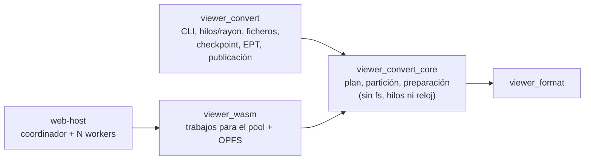

# Conversor web paralelo con paridad CLI

Estado: spec aprobada (29-10-2026), con enmiendas del pre-mortem · Decisiones:
[ADR 0014](../adr/0014-nucleo-de-conversion-sin-io.md),
[ADR 0015](../adr/0015-pool-de-workers-sin-memoria-compartida.md)

Primer subproyecto de «lectura y escritura paralelas en WASM». Planes: [etapa 1](conversor-web-paralelo-etapa1.md) (S0, M0, S1 y tests de independencia; cerrada) y [etapa 2](conversor-web-paralelo-etapa2.md) (modelo por nodos, S0 con bloques reales, S8 y M1). La lectura paralela tendrá spec
propia (enfoque async + workers, a concretar) y queda fuera de este documento.

## Objetivo

El navegador convierte LAS/LAZ/COPC locales a `.oct`/`.octattrs` con el **mismo pipeline que
`viewer_convert`** y **bytes idénticos** al CLI, repartiendo CPU entre varios workers y usando la
RAM disponible (4–8 GB en total) para reducir tráfico a disco, hasta datasets del tamaño de Majadas.

## Situación de partida (29-10-2026)

| Aspecto | CLI (`viewer_convert`) | Navegador (`viewer_wasm/src/browser_convert.rs`) |
| --- | --- | --- |
| Plan espacial | Octree adaptativo, divisiones 2/4/8 | Rejilla fija 2×2×2, jerarquía de 9 nodos (`:19-20`) |
| Puntos por bloque | 262 144 (`options.rs:5`) | 16 384 (`:17`) |
| Límite de bloque del writer | 64 MiB (`las_source.rs:375`) | 8 MiB (`:506`); cambia la codificación |
| Paralelismo | rayon en preparación, `thread::scope` en subárboles raíz | Un worker, un hilo |
| Presupuesto de memoria | 512 MiB por defecto | Ninguno |
| Medidas | Belvedere y Majadas registrados | Solo pruebas funcionales (111 190 puntos) |

El CLI produce bytes independientes del número de workers en lo probado: N = 1 frente a 2, LAS de
200 y 24 puntos, divisiones 4 (`lib_tests.rs:499-511`, `:682-705`), y 3 ejecuciones Belvedere con
el mismo SHA ([REAL_DATASET_BENCH](../records/benchmarks/REAL_DATASET_BENCH.md)). LAZ, divisiones 8
y N = 8 no están cubiertos. `viewer_convert --lib` compila para `wasm32-unknown-unknown` salvo la
dependencia `ctrlc`; los bloqueos reales son de ejecución: rutas `std::fs` como identidad de spool,
hilos, `Instant::now()` y `PreparedPointBlock` sin forma serializable.

### Bloqueos comprobados por el pre-mortem (29-10-2026)

| Bloqueo | Evidencia | Respuesta |
| --- | --- | --- |
| **LZ4 distinto en wasm32**: `lz4_flex` 0.14 elige el hash por ancho de puntero (5 B/u64 en 64 bits, 4 B en wasm32). Mismo bloque de 600 KB: 641 978 B nativo, 636 050 B wasm32 | `codec.rs:55`; `lz4_flex-0.14.0/src/block/hashtable.rs:26-50`; sonda reproducible | Spike bloqueante S0: parche de `lz4_flex` para que wasm32 use la ruta de 64 bits; el conversor web actual ya difiere del CLI por esto |
| **`seek` LAZ incorrecto con chunks variables (COPC)**: `laz` 0.13 calcula `point_idx % chunk.point_count`; con chunks [7,13,5,11,50000,3], 4 de 6 inicios de chunk devuelven el punto equivocado | `laz-0.13.0/src/laszip/sequential/decompression.rs:~203`; sonda | `PointSource` no usa `Reader::seek` en chunks variables: empieza a decodificar en el offset de bytes del chunk (tabla ya validada, ADR 0012) o parchea `laz`; fixture multi-chunk variable |
| **OPFS no admite un `SpoolStore` síncrono como el nativo**: el nativo crea spools hijos a mitad de escaneo (`spatial.rs:787`, `:954`), reabre en cada vaciado (`:571-578`) y borra en mitad de la recursión (`:1013`, `:1061`); en OPFS abrir, crear handle y borrar son async | código citado | Diseño de spool por arenas de trabajo (abajo), decidido antes de M1 |

El aviso upstream de estos dos fallos de `las`/`laz` se añade al backlog (prioridad 9 del README),
sin enviarlo.

## Requisitos

| Id | Requisito |
| --- | --- |
| R1 | Para la misma entrada y las mismas opciones del planificador, cuando la conversión termina en ambos lados, el conversor web producirá `.oct`/`.octattrs` byte a byte iguales a los del CLI, con cualquier número de workers. |
| R2 | El navegador expondrá las opciones del CLI aplicables a LAS/LAZ (revisión de formato, puntos por bloque, error máximo, divisiones y `planner_budget`), con los mismos valores por defecto y el mismo significado que en el CLI. |
| R3 | La conversión repartirá decodificación LAZ, partición, subárboles, preparación de bloques y validación entre N workers (cada uno con su instancia wasm32); un único escritor publica en orden. |
| R4 | Antes de empezar, el conversor pedirá `navigator.storage.persist()`, estimará el pico OPFS con el modelo de arenas y rechazará con mensaje claro si la cuota no alcanza; durante la conversión, un `QuotaExceededError` aborta y limpia como cualquier error (R5). |
| R5 | Cuando un worker falle (error, trap o cancelación), la conversión abortará entera, terminará los workers y borrará sus temporales OPFS. |
| R6 | La salida se validará releyéndola completa (en paralelo) antes de entregarla, como el CLI. |
| R7 | El CLI no perderá rendimiento: SHA idénticos y mediana pareada Belvedere (perfil `perf`, ≥ 5 rondas A/B alternadas) dentro de ±3% de la referencia M0. |
| R8 | Funcionará servido con `python3 -m http.server` y desde el paquete `file://`, sin cabeceras COOP/COEP. En Chrome desde `file://` no hay OPFS ([spike S1](../records/benchmarks/OPFS_ARENA_SPIKE_2026-10-29.md)): ahí la conversión solo usa spools en RAM, limitada a `ram_budget` y con aviso; la escala completa requiere servir por HTTP local. Firefox desde `file://` admite la conversión completa (decisión del propietario, 29-10-2026). |
| R9 | Un `ram_budget` del host (por defecto 4 GB; máximo aceptado 8 GB) decide N y el umbral de spools en RAM. Es un objetivo de PSS medido, no una garantía: las estimaciones nativas no acotan la RAM real (RSS 606 MiB frente a 163 MB estimados en REAL_DATASET_BENCH). No cambia bytes ni el significado de `planner_budget`. |
| R10 | Los spools se mantendrán en RAM mientras quepan en su presupuesto y se volcarán a OPFS al superarlo, sin cambiar los bytes de salida. |

Fuera de alcance: reanudar en el navegador (checkpoint/resume), EPT en el navegador, Safari,
hilos con memoria compartida, lectura paralela del visor.

## Arquitectura

- **`viewer_convert_core`** (crate nuevo): lógica pura del pipeline. Sin `std::fs`, `std::thread`,
  `Instant` ni `laz-parallel`; un lint `disallowed-methods` y un `cargo check` wasm32 en
  `scripts/check.sh` lo garantizan. Sin `dyn` ni asignaciones por punto en el bucle caliente.
- **`viewer_convert`**: shell nativo. Implementa los traits con ficheros e hilos y conserva CLI,
  checkpoints, EPT y publicación.
- **`viewer_wasm`**: shell del navegador. Expone cada tipo de trabajo como función wasm-bindgen e
  implementa los traits sobre OPFS y Blob. Sustituye a `browser_convert.rs`, que se elimina.
- **web-host**: un coordinador (worker líder) reparte trabajos a un pool de N workers y es el único
  escritor de la salida.

### Traits del núcleo

| Trait | Responsabilidad | Nativo | Navegador |
| --- | --- | --- | --- |
| `SpoolStore` | Spools por identificador lógico dentro de la arena de un trabajo (abajo) | Ficheros en el directorio de trabajo | `ArrayBuffer` de JS; volcado a la arena OPFS del trabajo |
| `PointSource` | Leer puntos por rango de chunks LAZ (o rango de registros LAS), con offset global de punto para errores | `las::Reader` con `laz-parallel` | Decodificador secuencial que empieza en el offset de bytes del chunk (sin `Reader::seek` en chunks variables) |
| `Clock` | Tiempos de diagnóstico | `Instant` | `performance.now()` |
| Trabajos | Entradas/salidas serializables de cada fase | Ejecutados por hilos/rayon | Mensajes a workers, búferes transferibles |

`viewer_format` añade una forma serializable de `PreparedPointBlock` (`PreparedWire`), coherente
con [ADR 0006](../adr/0006-politica-de-version-solo-en-viewer-format.md): la versión sigue
decidiéndose solo allí.

### Spools por arenas de trabajo

> **Decisión del propietario (29-10-2026), tras el [spike S1](../records/benchmarks/OPFS_ARENA_SPIKE_2026-10-29.md):** las arenas de solo añadido por subárbol alcanzan 1,9–6,5× el pico nativo de disco. La etapa 2 usa **trabajos por nodo**: cada trabajo lee la entrada de un nodo y escribe sus hijos en una arena nueva; el host borra la arena del padre cuando todos sus hijos la han consumido. El modelo de pico de este diseño se mide antes de M1.

Cada trabajo síncrono recibe del host, ya abierta, una **arena**: un fichero OPFS de solo añadido
con su handle síncrono (en el navegador) o un directorio (en nativo). Todos los spools que el trabajo
crea son **extensiones** (listas de rangos) dentro de su arena o segmentos `ArrayBuffer` en RAM; el
núcleo no abre ni borra ficheros a mitad de un trabajo. Al acabar, el trabajo devuelve qué spools
siguen vivos para fases posteriores; el host borra las arenas de **generaciones** ya consumidas entre
trabajos. Así, un trabajo usa un handle en vez de hasta 512 (divisiones 8), y el pico OPFS se modela
como bytes de las generaciones vivas, no como el conjunto vivo nativo. El spike S1 mide ese modelo
antes de M1 y los traits de M1 lo expresan desde el principio.

## Flujo de datos

| Fase | Paralelismo en el navegador | Cruza entre workers | Determinismo |
| --- | --- | --- | --- |
| 0. Preflight | Coordinador | — | `preflight_las` + tabla de chunks (ADR 0012) |
| 1. Partición raíz | W trabajos por rangos de chunks; cada uno escribe segmentos por hijo | Referencia al `Blob` + ~128 KiB de acumuladores | El spool lógico es la concatenación de segmentos en orden de chunk (`spatial.rs:781-799`); sumas u128 (`:1444`); min/max solo para «todos iguales» (`:815`); punto más cercano con `<` estricto, segmento anterior primero (`:1451-1457`). Casos aparte: raíz con todos los puntos iguales (`:815-839`) y raíz no divisible (`:739`) |
| 2. Jerarquía | Un trabajo por subárbol raíz; reparto dinámico | `RootChildTask` → `BranchOutput` (< 10 MB) | Ordenación por clave y renumeración como `append_branch` (`:1244-1301`) |
| 3. Preparación | Un trabajo por bloque planificado | `PreparedWire` como `ArrayBuffer` transferido | Cada bloque es puro; LZ4 igual en wasm32 tras S0 |
| 4. Escritura | Un escritor con ventana de reordenación acotada | — | Orden de identificador de bloque |
| 5. Validación | Lectores en paralelo sobre `getFile()` tras cerrar el handle | — | Igual que `publish.rs` |

## Memoria y disco

- **RAM por trabajo** (fórmulas nativas): preparación ≈ 192 B × 262 144 + 1 MiB ≈ 49 MiB; partición
  ≈ 80–100 MiB.
- **Dos presupuestos separados**: `planner_budget` tiene el significado del CLI (512 MiB por defecto,
  repartido por lote con `branch_memory_budget`, `spatial.rs:1971`) y decide `MemoryBudgetExceeded`
  igual en ambos lados; `ram_budget` (R9) es del host y solo decide N y el umbral de spools en RAM.
- **Spools por niveles (RAM primero, disco al crecer)**: segmentos en `ArrayBuffer` de JS (fuera de
  la memoria wasm, transferibles sin copia) mientras quepan en el presupuesto de spools; al
  superarlo, se vuelcan a la arena OPFS los spools mayores o los que se consumirán más tarde. Leer un
  spool devuelve los mismos bytes venga de RAM o de OPFS, así que no afecta a R1.
- La memoria wasm crece bajo demanda y no se libera al sistema: los workers se reciclan entre fases.
- **Número de workers frente a memoria por worker**: la memoria por trabajo es pequeña y los spools
  en RAM viven en JS, así que no hacen falta workers grandes. Hipótesis de partida: N ≈ núcleos
  físicos (8–10 en el equipo de referencia, 20 hilos) con ≈ 512 MiB–1 GiB de memoria wasm cada uno,
  y el resto del presupuesto para spools. Pocos workers grandes (2 × 4 GB) dejan la CPU ociosa;
  muchos pequeños (16 × 500 MB) añaden arranque, copias del plan e instancias sin ganar CPU más allá
  de los núcleos, y el escritor único y la contención OPFS limitan la escala (Amdahl). Lo decide S7.
- **OPFS**: niveles altos de spool y la pareja de salida (~7,5 GB) pasan por OPFS. El pico nativo
  de Majadas no se midió con exactitud (se observaron ~26 GB, REAL_DATASET_BENCH); el pico web sale
  del modelo de arenas de S1 y se mide en M6. La entrada sigue siendo un `File`, sin copiar.

## Errores

| Situación | Comportamiento |
| --- | --- |
| Cuota estimada insuficiente o `persist()` denegado con estimación mayor que la cuota | Rechazo antes de empezar (R4) |
| `QuotaExceededError` durante la conversión | Aborto global y limpieza (R4, R5) |
| Error tipado en un trabajo | Aborto global, limpieza OPFS, mensaje con la fase y el índice global de punto |
| Trap wasm (pánico del decodificador LAZ, sin `catch_unwind` en wasm) | Igual que un error; el worker se descarta |
| Cancelación del usuario | Aborto en el siguiente límite de trabajo y limpieza |
| Temporales huérfanos de una sesión anterior | Se borran al iniciar el conversor |

## Verificación

- **Paridad**: SHA de la pareja web = SHA del CLI con las mismas opciones, para N = 1, 2, 4, 8, en
  Chrome y Firefox (escritorio Linux). Casos: LAS pequeño de `data/`, `autzen.copc.laz`, un LAZ con
  varios chunks de tamaño variable, Belvedere; Majadas en M6. Opciones: valores por defecto del CLI
  y divisiones 8.
- **Igualdad de codificación nativo/wasm32**: test de `viewer_format` (preparación y writer) que
  compara bytes nativos con los de wasm32 ejecutado en node, en `scripts/check.sh` (S0).
- **Nativo**: tests de independencia de workers ampliados a N ∈ {1, 2, 4, 8} × divisiones
  {2, 4, 8} × LAS/LAZ; SHA idénticos y R7 en cada hito que toque el núcleo.
- **Rendimiento web**: tiempo total y por fase, pico de RAM (PSS) y pico OPFS; mismas condiciones
  por ronda, medianas y rango, registradas en `docs/records/benchmarks/`.
- **Navegador real** con Playwright: progreso, cancelación, error y recuperación, cuota insuficiente.
- Tests de unidad del núcleo con `SpoolStore` en memoria, y regresiones de la fusión de segmentos y
  acumuladores frente a la ejecución secuencial, incluidos raíz con puntos iguales, raíz no divisible
  e índices de error.

## Hitos

| Hito | Entrega | Criterio de cierre | Criterio de parada |
| --- | --- | --- | --- |
| S0 | Igualdad de bytes nativo/wasm32 en `viewer_format` con `lz4_flex` parcheado; test en `check.sh` | Bytes idénticos en fixtures y bloques Belvedere | Sin igualdad tras 3 días: consultar si los SHA nativos pueden cambiar (choca con R7) |
| M0 | Referencia: SHA del CLI (LAS pequeño, autzen, LAZ multi-chunk, Belvedere, Belvedere divisiones 8, Majadas) y tiempos Belvedere, perfil `perf`, ≥ 5 rondas alternadas, con tiempo de jerarquía | Registro fechado | — |
| S1 | Modelo y medida de arenas OPFS (bytes escritos frente a vivos, handles, añadidos de 32 KiB y 1 MiB) | Modelo validado; forma de `SpoolStore` fijada | Pico modelado > 1,5 × el conjunto vivo, u OPFS no disponible en `file://` en Firefox: replantear `SpoolStore` o volver a R8 con el propietario |
| M1 | Traits (con arenas) extraídos dentro de `viewer_convert`, sin cambio de comportamiento; tests de independencia ampliados | SHA idénticos; R7 | Regresión > 3% tras dos intentos: revertir la extracción |
| M2 | `viewer_convert_core` separado; compila para wasm32; partición por rangos de chunks ejecutada en nativo con W = 1..8 | SHA iguales para todo W en Belvedere y LAZ multi-chunk; check wasm32 y lint en `check.sh` | El núcleo necesita `dyn` o asignación por punto |
| M3a | Conversión web con un worker sobre el núcleo, LAS pequeño | Paridad (N = 1) en Chrome y Firefox | SHA distinto sin explicación tras una semana |
| M3b | Un worker con arenas OPFS a escala Belvedere; se elimina `browser_convert.rs` | Paridad (N = 1); tiempo registrado | Wasm con un worker > 4 × nativo en Belvedere: replantear |
| M4 | Pool para preparación y escritor ordenado | Paridad N = 1, 2, 4, 8; curva de tiempos; S7 | Escritor > 50% del tiempo con N = 4, o N = 4 < 1,5 × más rápido: revisar ADR 0015 |
| M5 | Pool para partición raíz y subárboles; validación paralela | Paridad; curva de tiempos; R7 | Aceleración de jerarquía con N = 8 < 1,5 × en Majadas: diseñar división bajo la raíz antes de M6 |
| M6 | Escala Majadas: preflight de cuota, spool en RAM, limpieza | SHA Majadas = CLI; picos de RAM y OPFS registrados | Pico OPFS > 1,3 × la estimación de R4, o Majadas > 60 min |

## Spikes

Sus resultados pueden cambiar umbrales y granularidad, nunca R1.

| Spike | Pregunta | Antes de |
| --- | --- | --- |
| S0 | Igualdad de bytes nativo/wasm32 (LZ4 y floats) | M1 |
| S1 | Arenas OPFS: pico modelado y medido, handles, tamaño de añadido | M1 |
| S2 | Velocidad del decodificador LAZ secuencial en wasm frente a nativo; arranque en offset de chunk; COPC con chunks variables | M3a |
| S3 | Coste de transferir `PreparedWire` y clonar el `Blob` por trabajo | M4 |
| S4 | Arranque: compilar `WebAssembly.Module` una vez y enviarlo, frente a base64 por worker (`package-local.py`); workers anidados desde un worker `blob:` | M4 |
| S5 | Cuota real, `persist()`, OPFS y `getFile()` tras cerrar el handle, en `http.server` y `file://`, Chrome y Firefox, a 30 GB | M3b |
| S7 | Dimensionado: tiempo total, PSS y OPFS para N = 2, 4, 8, 12, 16 con el mismo `ram_budget` (4 y 8 GB) y reparto entre memoria wasm y spools en RAM; Belvedere en Chrome y Firefox | Cierre de M4 |
| S8 | Cuota OPFS real con `persist()` en perfiles reales de Chrome y Firefox, y si cabe Majadas (≈ 19 GiB de spools vivos más la pareja de salida); decisión del propietario, 29-10-2026 | M6 |

## Riesgos

| Riesgo | Mitigación |
| --- | --- |
| LZ4 u otra codificación difiere entre nativo y wasm32 | S0 bloqueante y test permanente en `check.sh` |
| `seek` de `laz` incorrecto en COPC | `PointSource` arranca en el offset de bytes del chunk; fixture multi-chunk variable |
| `SpoolStore` síncrono sobre OPFS async obliga a rehacer el núcleo | Arenas por trabajo fijadas en S1 antes de M1 |
| Pico OPFS por encima de la cuota en Majadas | Modelo de arenas, spool en RAM, rechazo temprano y aborto limpio (R4) |
| Subárbol rezagado alarga la jerarquía de Majadas | Medir en M5; dividir bajo la raíz si no escala |
| R7 medido dentro del ruido | ≥ 5 rondas A/B alternadas y mediana pareada |
| Regresión nativa por los traits | Despacho estático en el bucle caliente; R7 en cada hito |
| La extracción del núcleo rompe checkpoints/EPT | Se quedan en el shell nativo; sus tests existentes siguen verdes |
