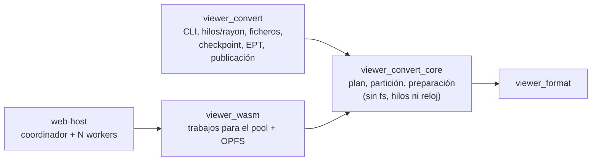

# Conversor web paralelo con paridad CLI

Estado: spec en revisión · Fecha: 29-10-2026 · Decisiones: [ADR 0014](../adr/0014-nucleo-de-conversion-sin-io.md),
[ADR 0015](../adr/0015-pool-de-workers-sin-memoria-compartida.md)

Primer subproyecto de «lectura y escritura paralelas en WASM». La lectura paralela tendrá spec
propia (enfoque async + workers, a concretar) y queda fuera de este documento.

## Objetivo

El navegador convierte LAS/LAZ/COPC locales a `.oct`/`.octattrs` con el **mismo pipeline que
`viewer_convert`** y **bytes idénticos** al CLI, repartiendo CPU entre varios workers y usando la
RAM disponible (4–8 GB en total) para reducir tráfico a disco, hasta datasets del tamaño de Majadas.

## Situación de partida (29-10-2026)

| Aspecto | CLI (`viewer_convert`) | Navegador (`viewer_wasm/src/browser_convert.rs`) |
| --- | --- | --- |
| Plan espacial | Octree adaptativo, divisiones 2/4/8 | Rejilla fija 2×2×2, jerarquía de 9 nodos (`:19-20`) |
| Puntos por bloque | 262 144 (`options.rs:5`) | 16 384 (`:17`) |
| Límite de bloque del writer | 64 MiB (`las_source.rs:375`) | 8 MiB (`:506`); cambia la codificación |
| Paralelismo | rayon en preparación, `thread::scope` en subárboles raíz | Un worker, un hilo |
| Presupuesto de memoria | 512 MiB por defecto | Ninguno |
| Medidas | Belvedere y Majadas registrados | Solo pruebas funcionales (111 190 puntos) |

El CLI ya produce bytes independientes del número de workers (`lib_tests.rs:500`, `:682`;
3 ejecuciones Belvedere con el mismo SHA en
[REAL_DATASET_BENCH](../records/benchmarks/REAL_DATASET_BENCH.md)). `viewer_convert --lib` compila
para `wasm32-unknown-unknown` salvo la dependencia `ctrlc`; los bloqueos reales son de ejecución:
rutas `std::fs` como identidad de spool, hilos, `Instant::now()` y `PreparedPointBlock` sin forma
serializable.

## Requisitos

| Id | Requisito |
| --- | --- |
| R1 | Para la misma entrada y las mismas opciones, el conversor web producirá `.oct`/`.octattrs` byte a byte iguales a los del CLI, con cualquier número de workers. |
| R2 | El navegador expondrá las opciones del CLI aplicables a LAS/LAZ (revisión de formato, puntos por bloque, error máximo, divisiones, presupuesto); por defecto, las del CLI. |
| R3 | La conversión repartirá decodificación LAZ, partición, subárboles, preparación de bloques y validación entre N workers (cada uno con su instancia wasm32); un único escritor publica en orden. |
| R4 | Antes de empezar, el conversor pedirá `navigator.storage.persist()`, estimará el espacio OPFS necesario y rechazará con mensaje claro si la cuota no alcanza. |
| R5 | Cuando un worker falle (error, trap o cancelación), la conversión abortará entera, terminará los workers y borrará sus temporales OPFS. |
| R6 | La salida se validará releyéndola completa (en paralelo) antes de entregarla, como el CLI. |
| R7 | El CLI no perderá rendimiento: SHA idénticos y mediana Belvedere (perfil `perf`) dentro de ±3% de la referencia M0. |
| R8 | Funcionará servido con `python3 -m http.server` y desde el paquete `file://`, sin cabeceras COOP/COEP. |
| R9 | La RAM total de la conversión respetará un presupuesto configurable (por defecto ≤ 4 GB; máximo aceptado 8 GB), repartido por worker. |

Fuera de alcance: reanudar en el navegador (checkpoint/resume), EPT en el navegador, Safari,
hilos con memoria compartida, lectura paralela del visor.

## Arquitectura

- **`viewer_convert_core`** (crate nuevo): lógica pura del pipeline. Sin `std::fs`, `std::thread`,
  `Instant` ni `laz-parallel`; un lint `disallowed-methods` y un `cargo check` wasm32 en
  `scripts/check.sh` lo garantizan.
- **`viewer_convert`**: shell nativo. Implementa los traits con ficheros e hilos y conserva CLI,
  checkpoints, EPT y publicación.
- **`viewer_wasm`**: shell del navegador. Expone cada tipo de trabajo como función wasm-bindgen e
  implementa los traits sobre OPFS y Blob. Sustituye a `browser_convert.rs`, que se elimina.
- **web-host**: un coordinador (worker líder) reparte trabajos a un pool de N workers y es el único
  escritor de la salida.

### Traits del núcleo

| Trait | Responsabilidad | Nativo | Navegador |
| --- | --- | --- | --- |
| `SpoolStore` | Crear, añadir, leer y borrar spools por identificador lógico (no ruta) | Ficheros en el directorio de trabajo | OPFS por handles síncronos; RAM para subárboles bajo un umbral |
| `PointSource` | Leer puntos por rango de chunks LAZ (o rango de registros LAS) | `las::Reader` con `laz-parallel` | `las::Reader` secuencial sobre `Blob` |
| `Clock` | Tiempos de diagnóstico | `Instant` | `performance.now()` |
| Trabajos | Entradas/salidas serializables de cada fase | Ejecutados por hilos/rayon | Mensajes a workers, búferes transferibles |

`viewer_format` añade una forma serializable de `PreparedPointBlock` (`PreparedWire`), coherente
con [ADR 0006](../adr/0006-politica-de-version-solo-en-viewer-format.md): la versión sigue
decidiéndose solo allí.

## Flujo de datos

| Fase | Paralelismo en el navegador | Cruza entre workers | Determinismo |
| --- | --- | --- | --- |
| 0. Preflight | Coordinador | — | `preflight_las` + tabla de chunks (ADR 0012) |
| 1. Partición raíz | W trabajos por rangos de chunks; cada uno escribe segmentos `hijo-k.parte-w` | Referencia al `Blob` + ~128 KiB de acumuladores | El spool lógico es la concatenación de segmentos en orden de chunk; sumas y min/max se fusionan en ese orden; el punto más cercano usa `<` estricto |
| 2. Jerarquía | Un trabajo por subárbol raíz; reparto dinámico | `RootChildTask` → `BranchOutput` (< 10 MB) | Identificadores renumerados al fusionar en preorden |
| 3. Preparación | Un trabajo por bloque planificado | `PreparedWire` como `ArrayBuffer` transferido | Cada bloque es puro |
| 4. Escritura | Un escritor con ventana de reordenación acotada | — | Orden de identificador de bloque |
| 5. Validación | Lectores en paralelo sobre `getFile()` | — | Igual que `publish.rs` |

## Memoria y disco

- **RAM por worker** (fórmulas nativas): preparación ≈ 192 B × 262 144 + 1 MiB ≈ 49 MiB; partición
  ≈ 80–100 MiB. Presupuesto de 512 MiB por worker; con 6–8 workers, 3–4 GB más el coordinador.
- **Uso del margen de 4–8 GB**: `SpoolStore` en RAM para subárboles por debajo de un umbral
  (inicialmente 256 MiB por trabajo) y lotes de preparación más anchos. No cambia los bytes.
- La memoria wasm no se libera al sistema: los workers se reciclan entre fases.
- **OPFS**: los spools de niveles altos (~13,7 GB estimados para Majadas) y la pareja de salida
  (~7,5 GB) pasan por OPFS; pico estimado 23–30 GB. La entrada sigue siendo un `File`, sin copiar.

## Errores

| Situación | Comportamiento |
| --- | --- |
| Cuota insuficiente o `persist()` denegado y estimación mayor que la cuota | Rechazo antes de empezar (R4) |
| Error tipado en un trabajo | Aborto global, limpieza OPFS, mensaje con la fase |
| Trap wasm (pánico del decodificador LAZ, sin `catch_unwind` en wasm) | Igual que un error; el worker se descarta |
| Cancelación del usuario | Aborto en el siguiente límite de trabajo y limpieza |
| Temporales huérfanos de una sesión anterior | Se borran al iniciar el conversor |

## Verificación

- **Paridad**: SHA de la pareja web = SHA del CLI con las mismas opciones, para N = 1, 2, 4, 8, en
  Chrome y Firefox (escritorio Linux). Casos: LAS pequeño de `data/`, `autzen.copc.laz`
  (crate `las`), Belvedere; Majadas en M6. Opciones: valores por defecto del CLI y divisiones 8.
- **Nativo**: SHA idénticos y mediana Belvedere dentro de ±3% (R7) en cada hito que toque el núcleo.
- **Rendimiento web**: tiempo total y por fase, pico de RAM (PSS) y pico OPFS; mismas condiciones
  por ronda, medianas y rango, registradas en `docs/records/benchmarks/`.
- **Navegador real** con Playwright: progreso, cancelación, error y recuperación, cuota insuficiente.
- Tests de unidad del núcleo con `SpoolStore` en memoria, y regresiones de la fusión de segmentos y
  acumuladores frente a la ejecución secuencial.

## Hitos

| Hito | Entrega | Criterio de cierre |
| --- | --- | --- |
| M0 | Referencia: SHA y tiempos del CLI (LAS pequeño, autzen, Belvedere; perfil `perf`, 3 rondas) | Registro fechado |
| M1 | Traits extraídos dentro de `viewer_convert`, sin cambio de comportamiento | SHA idénticos; R7 |
| M2 | `viewer_convert_core` separado; compila para wasm32 | Check wasm32 y lint en `scripts/check.sh` |
| M3 | Conversión web con un worker sobre el núcleo; se elimina `browser_convert.rs` | Paridad (N = 1) en Chrome y Firefox; tiempo registrado |
| M4 | Pool para preparación y escritor ordenado | Paridad N = 1, 2, 4, 8; curva de tiempos; RAM por worker ≤ presupuesto |
| M5 | Pool para partición raíz y subárboles; validación paralela | Paridad; curva de tiempos; R7 |
| M6 | Escala Majadas: preflight de cuota, spool en RAM, limpieza | SHA Majadas = CLI; picos de RAM y OPFS registrados |

## Spikes previos

Se ejecutan antes de M3/M4 y sus resultados pueden cambiar umbrales, nunca R1.

| Spike | Pregunta | Afecta a |
| --- | --- | --- |
| S1 | Rendimiento OPFS con N workers y muchos handles; añadidos de 32 KiB frente a 1 MiB. `createSyncAccessHandle` es async: ¿preabrir handles o agrandar el búfer? | `SpoolStore` web |
| S2 | Velocidad del decodificador LAZ secuencial en wasm frente a nativo; coste de `seek` a inicio de chunk; COPC | Partición raíz |
| S3 | Coste de transferir `PreparedWire` y clonar el `Blob` por trabajo | Granularidad de trabajos |
| S4 | Arranque de workers: compilar `WebAssembly.Module` una vez y enviarlo, frente a base64 por worker (`package-local.py`) | Pool |
| S5 | Cuota real, `persist()` y OPFS en `file://` con 30 GB en Chrome y Firefox | R4, R8 |
| S6 | Determinismo float nativo frente a wasm en fixtures | R1 |

## Riesgos

| Riesgo | Mitigación |
| --- | --- |
| La paridad de bytes falla por float o por orden de fusión | S6 temprano; tests de fusión frente a ejecución secuencial |
| El escritor único domina el tiempo | Medir en M4; ventana de reordenación; revisar ADR 0015 si domina |
| OPFS lento o con cuota insuficiente en Firefox | S1/S5; spool en RAM; rechazo temprano (R4) |
| Regresión nativa por los traits | Despacho estático en el bucle caliente; R7 en cada hito |
| La extracción del núcleo rompe checkpoints/EPT | Se quedan en el shell nativo; sus tests existentes siguen verdes |
